# 업무 데이터 편집기 (work-data-editor)

엑셀(.xlsx) 시트와 Access(.accdb) 테이블을 열어 **찾고 · 고치고 · 저장하는** 파이썬 프로그램입니다.
연 표로 바로 **회귀 분석과 통계 검정**(데이터 정제 → 이상 탐지 → t 검정 · 분산분석 → 머신러닝 · 딥러닝 모델 9가지 비교 → 그래프)도 할 수 있습니다.
내 PC 안에서만 동작하며(인터넷 · 서버 불필요), 수업에서 "작은 자동화 프로그램이 커지면 이런 모습이 된다"를 보여 주는 예제입니다.

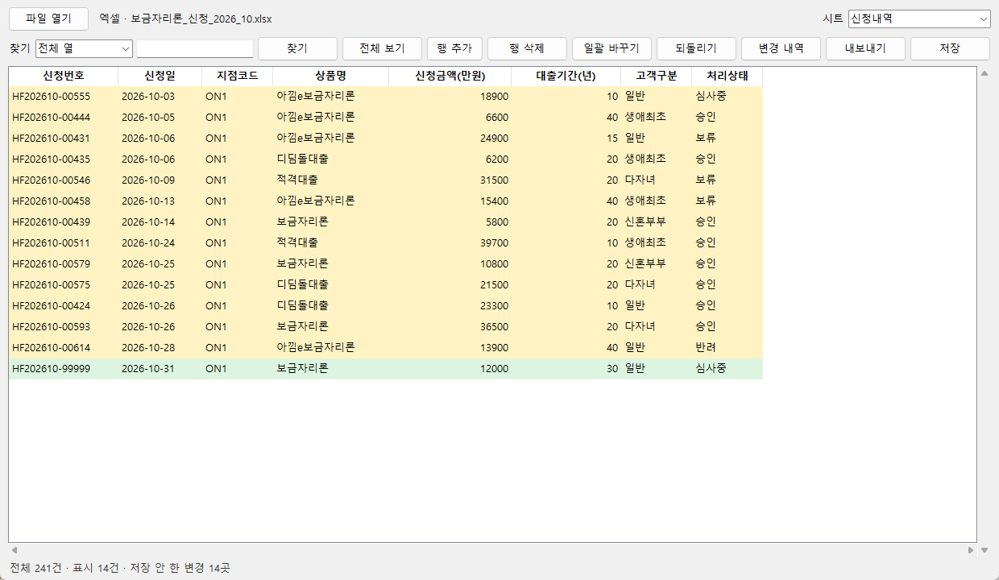

이 문서는 처음 하는 분도 따라 할 수 있도록 **VS Code 에서 폴더 열기 → 가상 환경 만들기 → 라이브러리 설치 → 실행 → 노트북** 순서로 적었습니다.

## 목차

1. [준비물](#1-준비물)
2. [내려받기](#2-내려받기)
3. [VS Code 에서 폴더 열기](#3-vs-code-에서-폴더-열기)
4. [가상 환경 만들기](#4-가상-환경-만들기)
5. [라이브러리 설치](#5-라이브러리-설치)
6. [pip freeze 와 requirements.txt](#6-pip-freeze-와-requirementstxt)
7. [프로그램 실행](#7-프로그램-실행)
8. [노트북으로 실행하기](#8-노트북으로-실행하기)
9. [프로그램 사용법](#9-프로그램-사용법)
10. [막혔을 때](#10-막혔을-때)
11. [회귀 분석 · 통계 검정 · 머신러닝](#11-회귀-분석--통계-검정--머신러닝)
12. [파일 구성 · 확인한 환경](#12-파일-구성--확인한-환경)

---

## 1. 준비물

| 준비물 | 설명 |
| --- | --- |
| Python 3.10 이상 | [python.org](https://www.python.org/downloads/) 에서 설치. 설치 첫 화면에서 **Add python.exe to PATH** 를 체크 |
| VS Code | [code.visualstudio.com](https://code.visualstudio.com/) |
| VS Code 확장 2개 | 왼쪽 확장(네모 4개) 아이콘에서 **Python**, **Jupyter** 를 검색해 설치 (둘 다 Microsoft 제작) |
| (선택) Access 드라이버 | Access 파일을 열 때만 필요. Access 가 설치된 PC 라면 보통 이미 있습니다 |

설치 확인: VS Code 메뉴 **터미널 → 새 터미널** 을 열고 아래를 입력합니다. 버전 숫자가 나오면 됩니다.

```
python --version
```

## 2. 내려받기

**방법 A — ZIP (쉬움)**: 이 페이지 위쪽 초록색 **Code** 버튼 → **Download ZIP** → 압축을 풀어 원하는 곳에 둡니다.

**방법 B — git**

```
git clone https://github.com/lsy3709/work-data-editor.git
```

## 3. VS Code 에서 폴더 열기

1. VS Code 메뉴 **파일 → 폴더 열기** 에서 `work-data-editor` 폴더를 고릅니다. (ZIP 으로 받았다면 `data_editor.py` 가 바로 보이는 폴더)
2. "이 폴더의 작성자를 신뢰합니까?" 가 나오면 **예** 를 누릅니다.
3. 메뉴 **터미널 → 새 터미널** 을 엽니다. 터미널의 경로 끝이 `work-data-editor` 인지 확인합니다.

파일 하나만 여는 것이 아니라 **폴더를 여는 것**이 중요합니다. 그래야 터미널 위치와 가상 환경이 이 폴더 기준으로 잡힙니다.

## 4. 가상 환경 만들기

가상 환경은 **이 폴더 전용 파이썬 상자**입니다. 여기에 설치한 라이브러리는 다른 작업에 영향을 주지 않습니다.

### 4-1. 만들기 (한 번만)

```
python -m venv .venv
```

폴더 안에 `.venv` 폴더가 생깁니다. 지워도 다시 만들면 됩니다.

### 4-2. 켜기 (터미널을 새로 열 때마다)

```
.venv\Scripts\Activate.ps1
```

줄 맨 앞에 `(.venv)` 가 붙으면 켜진 것입니다. 끌 때는 `deactivate` 를 입력합니다.

"이 시스템에서 스크립트를 실행할 수 없으므로…" 라는 빨간 글씨가 나오면, 터미널 오른쪽 위 `+` 옆 화살표에서 **Command Prompt** 를 골라 새 터미널을 열고 아래처럼 켭니다.

```
.venv\Scripts\activate.bat
```

### 4-3. VS Code 에 알려 주기

`Ctrl + Shift + P` → **Python: Select Interpreter** 입력 → 목록에서 **`.venv`** 가 들어간 항목을 고릅니다.
이렇게 해 두면 새 터미널을 열 때 가상 환경이 자동으로 켜지고, 오른쪽 위 ▶ 실행도 이 환경으로 돌아갑니다.

> VS Code 에 맡기는 방법도 있습니다: `Ctrl + Shift + P` → **Python: Create Environment** → **Venv** → 파이썬 버전 선택 → `requirements.txt` 체크. 4 · 5번을 한 번에 해 줍니다.

## 5. 라이브러리 설치

가상 환경이 켜진 터미널(`(.venv)` 표시)에서 설치합니다.

### 방법 A — 하나씩

```
pip install openpyxl
pip install pyodbc
pip install pandas
pip install ipykernel
pip install scikit-learn
pip install matplotlib
```

| 라이브러리 | 쓰는 곳 |
| --- | --- |
| openpyxl | 엑셀 읽기 · 쓰기 (필수) |
| pyodbc | Access 연결 (Access 를 안 쓰면 없어도 됨) |
| pandas | 노트북에서 표 보기 · 회귀 분석 |
| ipykernel | VS Code 에서 노트북 실행 |
| scikit-learn | 회귀 분석의 모델 9가지 · 이상 탐지. 통계 검정에 쓰는 scipy 도 함께 설치됨 (회귀 분석을 안 쓰면 없어도 됨) |
| matplotlib | 회귀 분석의 그래프 (회귀 분석을 안 쓰면 없어도 됨) |

### 방법 B — 한꺼번에 (권장)

필요한 라이브러리 이름을 적어 둔 `requirements.txt` 를 pip 에 넘깁니다.

```
pip install -r requirements.txt
```

설치된 것 확인:

```
pip list
```

## 6. pip freeze 와 requirements.txt

### requirements.txt 란

"이 프로젝트에 필요한 라이브러리 목록"을 적은 글자 파일입니다. 한 줄에 하나씩 씁니다.

```
openpyxl
pyodbc
pandas
ipykernel
```

이 파일이 있으면 다른 PC · 다른 사람도 `pip install -r requirements.txt` 한 줄로 같은 환경을 만듭니다.

### pip freeze — 지금 설치된 것을 버전까지 적어 내기

```
pip freeze
```

`openpyxl==3.1.5` 처럼 **이름==버전** 이 줄줄이 나옵니다. 내가 직접 설치한 4개 말고도, 그 라이브러리들이 필요로 해서 같이 깔린 것까지 모두 나옵니다.

파일로 저장하려면:

```
pip freeze > requirements-lock.txt
```

### 두 파일의 차이

| 파일 | 내용 | 언제 쓰나 |
| --- | --- | --- |
| `requirements.txt` | 직접 필요한 것만, 버전 없음 | 평소. 설치할 때의 최신 버전이 깔림 |
| `requirements-lock.txt` | `pip freeze` 결과, 버전 고정 | "내 PC 에서 되던 그 버전 그대로" 다시 만들 때 |

버전까지 똑같이 설치:

```
pip install -r requirements-lock.txt
```

이 저장소의 `requirements-lock.txt` 는 **Python 3.13** 에서 만든 것입니다. 다른 파이썬 버전에서는 일부 버전이 설치되지 않을 수 있으니 `requirements.txt` 를 쓰세요.

### 알아 둘 것

- **가상 환경을 켠 상태에서** freeze 하세요. 끈 상태에서 하면 PC 전체에 깔린 것이 모두 나옵니다.
- 라이브러리를 새로 설치했으면 `requirements.txt` 에 이름을 한 줄 추가합니다.
- `requirements.txt` 에는 **한글을 쓰지 마세요**(주석 포함). 한국어 Windows 의 pip 이 파일을 읽지 못해 `UnicodeDecodeError` 가 납니다. 이 프로젝트를 만들 때 실제로 겪은 문제입니다.
- `.venv` 폴더는 다른 사람에게 주지 않습니다. `requirements.txt` 만 주면 각자 만듭니다. (그래서 `.gitignore` 에 `.venv/` 가 들어 있습니다)

## 7. 프로그램 실행

### 7-1. 연습용 데이터 준비 (처음 한 번)

```
python reset_samples.py
```

`samples_original` 의 원본을 `samples` 폴더로 복사합니다. 연습하다가 처음 상태로 돌리고 싶을 때도 이 명령을 씁니다.

### 7-2. 실행

```
python data_editor.py
```

창이 뜨면 **[파일 열기]** 로 `samples` 폴더의 파일을 엽니다. 여러 파일을 함께 고르면 **파일마다 탭이 하나씩** 열립니다. 파일을 바로 지정할 수도 있습니다.

```
python data_editor.py samples\보금자리론_신청_2026_10.xlsx
python data_editor.py samples\보금자리론_신청_2026_10.xlsx samples\업무DB.accdb
```

둘째 줄처럼 파일을 여러 개 적으면 모두 탭으로 열립니다.

VS Code 에서 `data_editor.py` 를 열고 오른쪽 위 ▶ 를 눌러도 됩니다.

### 7-3. 제대로 설치됐는지 확인 (선택)

```
python test_data_editor.py
python test_analysis.py
python test_stat_tests.py
python gui_check.py
```

- 첫 줄: 화면 없이 핵심 기능 17가지를 검사합니다. 마지막에 `OK` 가 나오면 정상입니다. (pyodbc 가 없으면 `OK (skipped=3)`)
- 둘째 줄: 회귀 분석(정제 · 이상 탐지 · 모델 9가지 · 자동 분석) 17가지를 검사합니다. 20~30초 걸립니다.
- 셋째 줄: 통계 검정(t 검정 · 분산분석 · 회귀 계수 검정이 scipy 결과와 같은지) · 정제 · 학습 곡선 13가지를 검사합니다.
- 넷째 줄: 창을 실제로 띄워 열기 · 찾기 · 바꾸기 · 저장 · 여러 탭 · 동시에 열기 · 회귀 분석을 자동으로 해 봅니다. 창이 잠깐 떴다 닫히고 `RESULT PASS` 가 나오면 정상입니다.

## 8. 노트북으로 실행하기

노트북(`.ipynb`)은 코드를 **한 칸씩 실행하면서 결과를 바로 아래에서 보는** 방식입니다. 화면 프로그램이 속에서 하는 일을 따라가 보기에 좋습니다.

### 8-1. 준비

1. VS Code 확장 **Jupyter** 가 설치되어 있어야 합니다. ([1. 준비물](#1-준비물))
2. 가상 환경에 `ipykernel` 과 `pandas` 가 있어야 합니다. 5번에서 `pip install -r requirements.txt` 를 했다면 이미 있습니다.

### 8-2. 열고 커널 고르기

1. 왼쪽 탐색기에서 `notebook_tutorial.ipynb` 를 클릭합니다.
2. 노트북 오른쪽 위 **커널 선택**(Select Kernel) → **Python 환경** → **`.venv`** 가 들어간 항목을 고릅니다.
   커널은 "이 노트북을 실행할 파이썬"입니다. 4번에서 만든 가상 환경을 고르는 것입니다.
3. 목록에 `.venv` 가 없으면 VS Code 를 닫았다 다시 열거나, `Ctrl + Shift + P` → **Developer: Reload Window** 를 실행합니다.

### 8-3. 실행

- 칸(셀)을 클릭하고 `Shift + Enter` → 그 칸을 실행하고 다음 칸으로 이동
- 위쪽 **모두 실행**(Run All) → 처음부터 끝까지 실행
- 변수가 꼬였으면 위쪽 **다시 시작**(Restart) 후 처음부터

**1번 칸**의 결과에서 `실행 위치` 가 이 폴더의 `.venv` 안이면 환경이 맞게 잡힌 것입니다. 위에서부터 순서대로 실행하세요. 2번 칸은 연습용 데이터를 처음 상태로 되돌립니다.

### 8-4. 노트북에서 배우는 것

파일 열기 → 찾기 → 일괄 바꾸기 → 칸 고치기(잘못된 값 거부) → 행 추가 · 삭제 · 되돌리기 → 변경 내역 → 저장(백업) → pandas 로 확인 → Access. 마지막에 연습 문제 3개가 있습니다.

GitHub 에서 [notebook_tutorial.ipynb](notebook_tutorial.ipynb) 를 누르면 실행 결과가 들어 있는 상태로 미리 볼 수 있습니다.

## 9. 프로그램 사용법

| 기능 | 방법 |
| --- | --- |
| 파일 열기 | [파일 열기] 또는 `Ctrl+O`. 여러 파일을 함께 고르면 파일마다 탭이 열림. 엑셀은 시트, Access 는 테이블을 오른쪽 위에서 고름 |
| 탭 | 탭을 눌러 이동 또는 `Ctrl+Tab`. [탭 닫기] · `Ctrl+W` · 탭을 가운데 단추로 클릭 · 오른쪽 클릭 메뉴로 닫기. 이름 앞의 ● 는 저장 안 한 변경 |
| 찾기 | 열을 고르고(또는 전체 열) 글자를 넣고 Enter. [전체 보기]로 해제 |
| 정렬 | 열 이름 클릭 (다시 누르면 반대로) |
| 칸 고치기 | 칸을 더블클릭 → 입력 → Enter (Esc 취소). 숫자 · 날짜 열에 맞지 않는 값은 거부 |
| 행 추가 · 삭제 | [행 추가], 행을 고르고 [행 삭제] 또는 Delete |
| 일괄 바꾸기 | 한 열에서 ① 칸 전체가 같을 때 ② 일부 글자만 ③ 모두 같은 값으로 채우기 |
| 되돌리기 | [되돌리기] 또는 `Ctrl+Z` (저장 전까지, 최근 200번) |
| 변경 내역 | 저장하면 반영될 수정 · 추가 · 삭제 목록 |
| 저장 | [저장] 또는 `Ctrl+S`. 원본 옆 `백업` 폴더에 복사본을 먼저 만든 뒤 저장 |
| 내보내기 | 화면에 보이는 행만 새 엑셀 파일로 |

노란 줄은 고친 행, 초록 줄은 새로 넣은 행입니다.

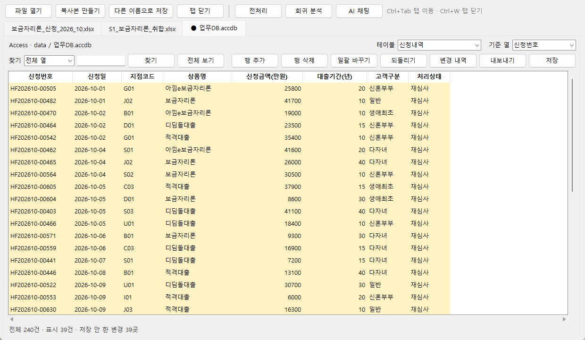

**여러 탭 · 큰 파일**

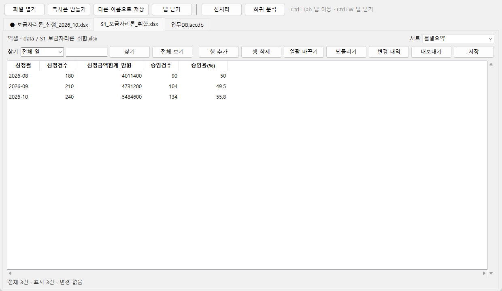

- **탭마다 따로**: 찾기 · 정렬 · 수정 · 되돌리기 · 저장은 지금 보고 있는 탭에만 적용됩니다. 이미 연 파일을 다시 열면 새 탭을 만들지 않고 그 탭으로 갑니다(같은 파일을 두 탭에서 고치면 저장이 서로 덮어쓰기 때문).
- **읽기 · 저장은 작업 스레드에서**: 파일을 읽거나 저장하는 동안에도 창이 멈추지 않고, 다른 탭은 계속 쓸 수 있습니다. 읽는 중 · 저장 중인 탭은 이름 앞에 `…` 가 붙고 그동안에는 고칠 수 없습니다. 저장 중인 탭과 프로그램은 저장이 끝나야 닫힙니다.
- **메모리**: 원본 표를 통째로 한 벌 더 두지 않고 고친 행의 처음 모습만 기억합니다. 엑셀은 값만 한 줄씩 흘려 읽고, 같은 글자(`승인`, `보금자리론` …)는 하나만 두고 함께 씁니다. 탭을 닫으면 그 표가 쓰던 메모리를 돌려줍니다.

| 5만 행 × 10열 엑셀로 잰 값 (Python 3.13) | 이전 | 지금 |
| --- | --- | --- |
| 읽는 동안 가장 많이 쓴 메모리 | 224 MB | 40 MB |
| 읽은 뒤 붙들고 있는 메모리 | 41 MB | 32 MB |
| 칸 하나 고칠 때마다 하는 상태 계산 20회 | 4.7초 | 0.03초 |
| 읽는 시간 | 6.6초 | 6.2초 |

- 스레드는 **창이 멈추지 않게** 하려는 것이지 읽기를 빠르게 하지는 않습니다. 파이썬은 한 번에 한 스레드만 계산하므로, 5만 행 파일 2개를 동시에 열면 하나씩 열 때와 비슷하게 약 14초가 걸립니다(그동안 창은 평균 8ms 간격으로 반응, 표를 그리는 순간에 0.3초쯤 끊김).
- 화면에는 탭마다 앞 5,000행까지만 그립니다. 찾기 · 일괄 바꾸기 · 저장은 전체 행에 적용됩니다.
- 엑셀 **저장**은 서식을 지키려고 파일 전체를 읽어 들이므로 큰 파일에서는 읽을 때보다 메모리를 많이 씁니다.

**저장 방식**

- **엑셀**: 고른 시트의 데이터만 다시 씁니다. 다른 시트와 머리글 서식은 그대로입니다. 엑셀에서 그 파일이 열려 있으면 저장할 수 없습니다.
- **Access**: 바뀐 곳만 반영합니다. 어느 행인지 알려 주는 **기준 열**(값이 행마다 다른 열, 예: 신청번호)이 필요하며 자동으로 골라 줍니다. 하나라도 실패하면 전부 취소합니다.

**따라 해 보기 (5분)**

1. `samples\보금자리론_신청_2026_10.xlsx` 열기 → 240건
2. 찾기: 열 `지점코드`, 글자 `X99` → 13건
3. [일괄 바꾸기]: `지점코드` 열, `X99` → `ON1` → 13줄이 노랗게
4. 금액 칸을 더블클릭해 글자를 넣어 보기 → 거부됨
5. [변경 내역] → [저장] → `samples\백업` 폴더에 복사본이 생긴 것 확인
6. `samples\업무DB.accdb` 를 열어 같은 방법으로 고치고 저장 → Access 에서 열어 확인

## 10. 막혔을 때

| 증상 | 이렇게 |
| --- | --- |
| `python` 을 찾을 수 없다고 나옴 | 파이썬 설치 때 **Add python.exe to PATH** 를 체크하지 않은 경우. 다시 설치하거나 `py` 로 바꿔 입력 (`py -m venv .venv`) |
| `Activate.ps1` … 스크립트를 실행할 수 없음 | Command Prompt 터미널에서 `.venv\Scripts\activate.bat` ([4-2](#4-2-켜기-터미널을-새로-열-때마다)) |
| `ModuleNotFoundError: No module named 'openpyxl'` | 가상 환경이 꺼져 있거나 설치를 안 한 경우. `(.venv)` 표시 확인 후 `pip install -r requirements.txt` |
| `pip install -r` 에서 `UnicodeDecodeError` | `requirements.txt` 에 한글이 들어 있음. 영문만 남기기 |
| 노트북에서 커널 목록에 `.venv` 가 없음 | `ipykernel` 설치 확인 후 **Developer: Reload Window** |
| 노트북에서 `No module named 'data_editor'` | 파일만 열지 말고 **폴더를 열어야** 합니다 ([3번](#3-vs-code-에서-폴더-열기)) |
| Access 에 연결하지 못했습니다 | pyodbc 설치 여부, Access 드라이버 설치 여부, 드라이버와 Python 의 비트 수(64/32)가 같은지 확인 |
| 엑셀 저장이 안 됨 | 엑셀에서 그 파일을 닫고 다시 저장 |
| 연습 데이터를 망쳤다 | `python reset_samples.py` |
| 분석할 때 터미널에 `wmic` · `physical cores` 가 들어간 긴 글이 찍힘 | 오래된 joblib 이 윈도우 11 에서 내는 안내로, 결과에는 영향이 없습니다. 없애려면 `pip install -U joblib` |

## 11. 회귀 분석 · 통계 검정 · 머신러닝

표의 한 열(**예측할 열** = 종속변수)을 다른 열들(**설명하는 열** = 독립변수)로 설명해 보는 기능입니다. 탭에서 파일을 연 뒤 위쪽 **[회귀 분석]** 을 누르면 분석 창이 따로 뜹니다.

- "이 열이 정말 관계가 있나?" → **통계 검정** (t 검정 · 분산분석 · 회귀 계수 t 검정)
- "그래서 얼마나 잘 맞히나?" → **머신러닝 · 딥러닝 모델 9가지** 비교
- 그 앞 단계인 **데이터 정제 · 이상 탐지**, 뒤 단계인 **그래프 · 엑셀 내보내기** 까지 한 창에서 합니다.

`pandas` · `scikit-learn` · `matplotlib` 이 필요하며([5번](#5-라이브러리-설치)), 없으면 설치 방법을 알려 주고 편집기는 그대로 쓸 수 있습니다.

회귀 · 정제 · 이상 탐지 · t 검정 · 머신러닝이 **무엇이고 어디서 온 말인지**는 그림 12장과 함께 **[docs/concept_guide.md](docs/concept_guide.md)** (개념 사전: 역사 · 어원 · 개념 · 쓰이는 곳 · 용어 풀이)에 따로 적었습니다.

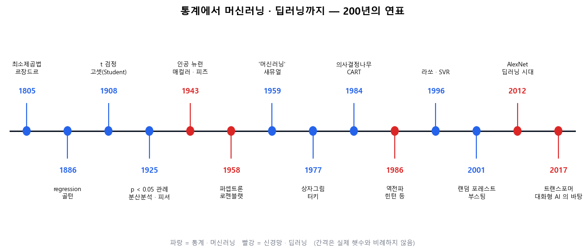

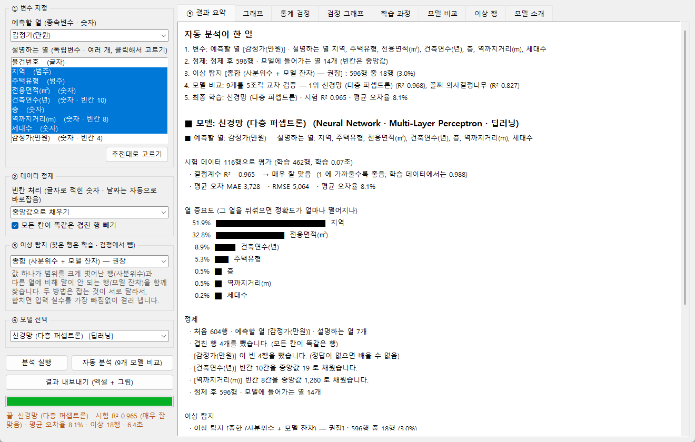

### 11-1. 화면 구성과 다섯 단계

왼쪽에서 ① ~ ④ 를 고르고 **[분석 실행]**, 잘 모르겠으면 **[자동 분석]** 을 누릅니다. 오른쪽에 ⑤ 결과가 탭 8개로 나옵니다.

| 단계 | 화면에서 하는 일 | 프로그램이 해 주는 것 |
| --- | --- | --- |
| ① 변수 지정 | 예측할 열(종속변수) 하나, 설명하는 열(독립변수) 여러 개를 고름 | 숫자 열을 예측 대상으로, 번호표 같은 열은 빼고 추천. 열마다 종류(숫자 · 범주 · 날짜 · 글자)와 빈칸 수 표시 |
| ② 데이터 정제 | 빈칸을 중앙값 · 평균으로 채울지, 그 행을 뺄지 고름 | 글자로 적힌 숫자 · 날짜 바로잡기, 앞뒤 빈칸 지우기, 겹친 행 제거, 글자 열을 0/1 열로 펼치기 |
| ③ 이상 탐지 | 방법 5가지 중 하나 | 이상한 행을 학습 · 검정에서 빼고 **이유를 글로** 표시 (지우지는 않음) |
| ④ 모델 선택 | 9가지 중 하나 | 값 크기 맞추기 같은 준비는 모델에 맞게 자동 |
| ⑤ 결과 | 탭 8개: 결과 요약 · 그래프 · 통계 검정 · 검정 그래프 · 학습 과정 · 모델 비교 · 이상 행 · 모델 소개 | R² · 평균 오차 · 열 중요도 · 검정 결과, 엑셀 + 그림 3장으로 내보내기 |

**[자동 분석]** 은 ① ~ ⑤ 를 한 번에 돌립니다: 변수 추천 → 중앙값으로 채움 → 종합 방식으로 이상 탐지 → 모델 9가지를 교차 검증으로 비교 → 1위 모델로 학습 → 통계 검정 → 학습 곡선.

### 11-2. 데이터 정제

사람이 손으로 넣은 표에서 흔한 문제를 분석 전에 바로잡고, **무엇을 했는지 한 줄씩 적어 줍니다**([결과 요약] 탭과 [학습 과정] 탭).

| 문제 | 처리 |
| --- | --- |
| 숫자가 글자로 들어옴 (`2,430,000원`, ` 1,140,000 `) | 쉼표 · `원` · `%` 를 떼고 숫자로. 한 열의 70% 이상이 숫자로 읽힐 때만 |
| 날짜 표기가 섞임 (`2026/07/15`, `2026.01.03`, `20260613`) | 날짜로 통일. 못 읽은 칸은 빈칸으로 |
| 앞뒤 빈칸 (` 김하나`) | 지움 — 그래야 겹친 행을 알아볼 수 있음 |
| 모든 칸이 똑같은 겹친 행 | 하나만 남김 |
| 예측할 열이 빈 행 | 뺌 (정답이 없으면 배울 수 없음) |
| 설명하는 열의 빈칸 | 중앙값 · 평균으로 채우거나 그 행을 뺌 (고르기). 글자 열은 가장 흔한 값으로 |
| 글자 열 (`지역`, `주택유형`) | 값마다 0/1 열로 펼침 (`지역=서울` …). 값이 20가지를 넘으면 나머지는 `기타` |
| 날짜 열 | "첫 날부터 지난 날 수" 로 |
| 번호 · 이름처럼 행마다 다른 열 | 쓰지 않음 |

수업의 정제용 샘플(`주택연금_가입현황_정제전.xlsx`)을 그대로 넣은 화면입니다. 금액 61칸 · 날짜 61칸을 바로잡고 겹친 행 2개를 뺐다고 적혀 있습니다.

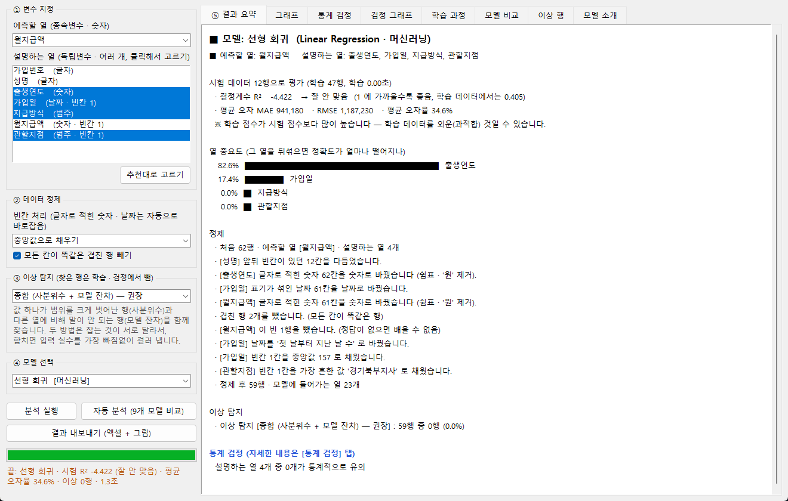

### 11-3. 이상 탐지

| 방법 | 설명 |
| --- | --- |
| 종합 (권장) | 사분위수 + 모델 잔차를 함께. 두 방법은 잡는 것이 서로 달라 합치면 입력 실수를 가장 빠짐없이 걸러 냄 |
| 모델 잔차 | 랜덤 포레스트가 그 행을 빼고 배운 뒤 예측한 값과 실제 값을 견주어, 몇 배나 어긋났는지로 판단 |
| 사분위수 범위 (IQR) | 가운데 절반이 차지하는 폭의 3배 넘게 벗어난 값 (터키, 1977) |
| 표준점수 (Z-score) | 평균에서 표준편차의 3배 넘게 떨어진 값 |
| 고립 숲 (Isolation Forest) | 무작위로 칸을 나누다 보면 남다른 행은 금방 혼자 남는다는 점을 씀 (2008) |

[이상 행] 탭에 행마다 이유가 나옵니다. **[편집기에서 이 행들만 보기]** 를 누르면 편집기 탭에 그 행들만 남으므로, 값을 고친 뒤 다시 분석하면 됩니다.

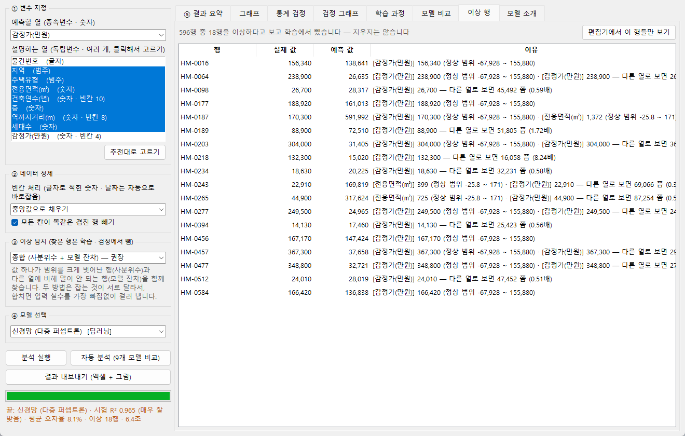

### 11-4. 통계 검정 — t 검정 · 분산분석 · 회귀 계수 검정

설명하는 열마다 **예측할 열과 관계가 있는지** 검정합니다. 열의 종류를 보고 방법을 알아서 고릅니다.

| 설명하는 열 | 검정 방법 | 보는 것 | 효과 크기 |
| --- | --- | --- | --- |
| 숫자 열 | 피어슨 상관 t 검정 | 상관계수 r 이 0 과 다른가. `t = r·√(n−2) / √(1−r²)` | r |
| 글자 열, 두 집단 | 독립표본 t 검정 (Welch) | 두 집단의 평균이 다른가 (퍼짐이 달라도 되는 방식) | 코헨 d |
| 글자 열, 세 집단 이상 | 일원분산분석 (ANOVA) + 사후 t 검정 | 집단 평균이 모두 같은가(F). 다르면 어느 집단끼리 다른지 둘씩 t 검정, 본페로니 보정 | 에타 제곱 η² |
| 모든 열을 함께 | 다중 회귀의 계수 t 검정 | 다른 열이 같을 때도 이 열이 유의한가. `t = 계수 ÷ 표준오차`, 95% 신뢰구간 | 계수 |

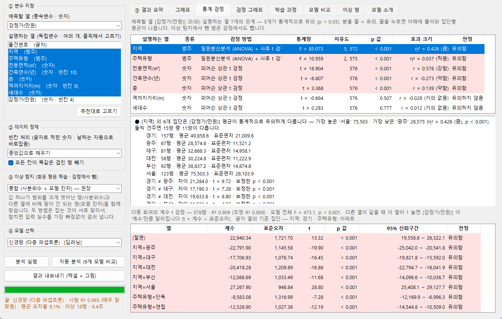

- 위 표: 열마다 검정 방법 · 통계량 · 자유도 · p 값 · 효과 크기 · 판정. 분홍 줄이 유의한 열입니다.
- 가운데: 고른 줄의 **풀이 문장**, 집단별 행 수 · 평균 · 표준편차, 둘씩 견준 결과(`≠` 다름, `≈` 다르다고 할 수 없음).
- 아래 표: 모든 열을 함께 넣은 회귀의 계수마다 t 검정. 글자 열은 가장 흔한 값을 **기준 집단**으로 두고 "기준보다 얼마나 높은가"로 나타냅니다.

[검정 그래프] 탭은 p 값이 작은 순으로 열 4개(숫자 = 산점도와 추세선, 글자 = 상자그림), 회귀 계수의 t 값, 열마다의 p 값을 그립니다. 빨강이 유의한 것입니다.

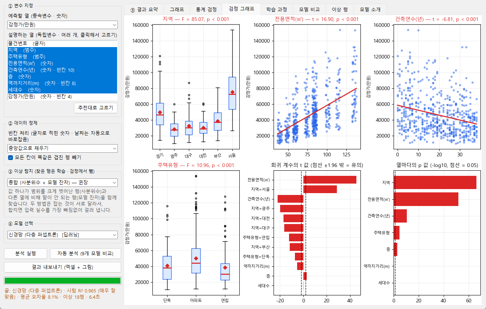

**읽는 법**

- **귀무가설**은 "관계가 없다(차이가 없다)"입니다. **p 값**은 정말 관계가 없는데도 우연히 이만큼 차이가 날 확률입니다.
- `p < 0.05` 이면 "통계적으로 유의하다"고 합니다. 0.05 는 관례일 뿐 절대 기준이 아닙니다.
- **유의하다 ≠ 중요하다.** 행이 많으면 아주 작은 차이도 유의해집니다. 그래서 효과 크기(r · d · η²)를 함께 보여 줍니다.
- **열을 여러 개 검정하면** 관계가 전혀 없어도 20개에 1개꼴로 우연히 유의하게 나옵니다. 유의한 열이 한둘이고 효과가 작다면 우연일 수 있습니다.
- t 검정이라는 이름은 고셋(W. S. Gosset)이 1908년 `Student` 라는 필명으로 발표한 데서 왔습니다(기네스 맥주 회사의 품질 관리 문제였습니다).
- 값은 `scipy` 의 결과와 같은지 자동 테스트로 확인합니다(`test_stat_tests.py`).

### 11-5. 모델 9가지

| 모델 | 계열 | 한 줄 소개 |
| --- | --- | --- |
| 선형 회귀 | 머신러닝 | 열마다 가중치를 곱해 더하는 가장 오래된 모델 (1805 최소제곱법, 1886 골턴의 regression) |
| 릿지 회귀 | 머신러닝 | 계수를 너무 키우지 않게 벌점을 준 선형 회귀 (1970) |
| 라쏘 회귀 | 머신러닝 | 쓸모없는 열의 계수를 0 으로 만들어 골라 주는 선형 회귀 (1996) |
| 의사결정나무 | 머신러닝 | 예/아니오 질문을 되풀이해 무리로 나눔 (1984 CART) |
| 랜덤 포레스트 | 머신러닝 | 조금씩 다른 나무 수백 그루의 평균 (2001) |
| 그레이디언트 부스팅 | 머신러닝 | 앞 나무가 틀린 만큼을 다음 나무가 배움 (2001) |
| k-최근접 이웃 | 머신러닝 | 가장 닮은 k개 행의 평균 (1951) |
| 서포트 벡터 회귀 | 머신러닝 | 허용 오차 띠 밖의 행만 벌점 (1996) |
| 신경망 (다층 퍼셉트론) | 딥러닝 | 뉴런 층을 겹쳐 쌓음 (1958 퍼셉트론, 1986 역전파) |

④ 에서 모델을 고르면 [모델 소개] 탭에 **이름의 뜻(어원) · 역사 · 하는 일 · 언제 쓰나** 가 나옵니다. 같은 내용 전체가 [docs/ml_guide.md](docs/ml_guide.md) 에 있습니다. CNN · RNN · 트랜스포머 같은 본격 딥러닝 모델은 이 프로그램에 넣지 않고 그 문서에서 소개만 합니다.

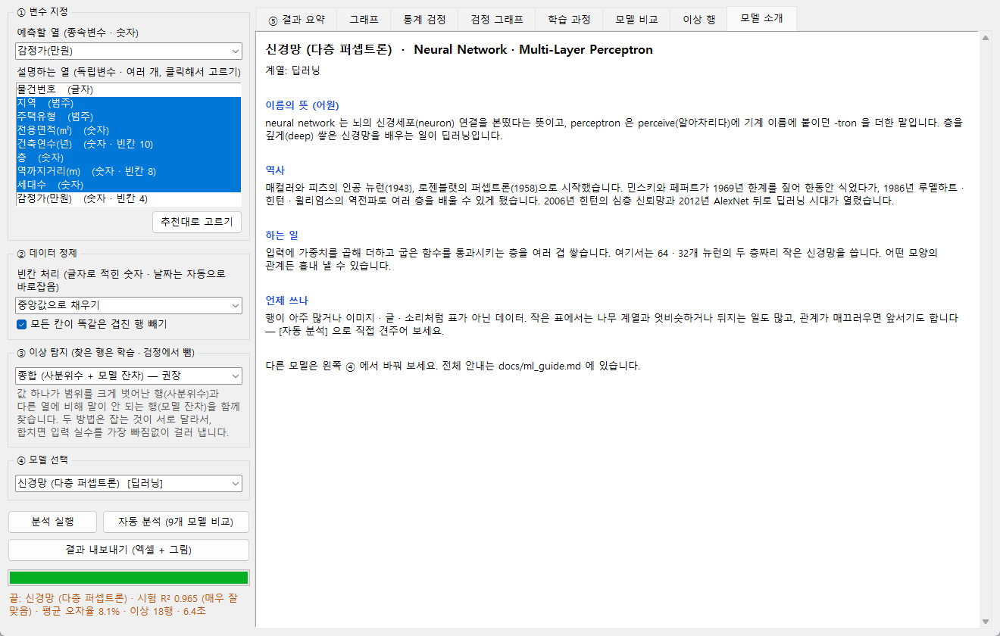

[모델 비교] 탭은 [자동 분석] 때 채워집니다. 모델이 하나 끝날 때마다 한 줄씩 들어오고, 끝나면 점수 순으로 정렬됩니다. 줄을 더블클릭하면 그 모델로 다시 분석합니다.

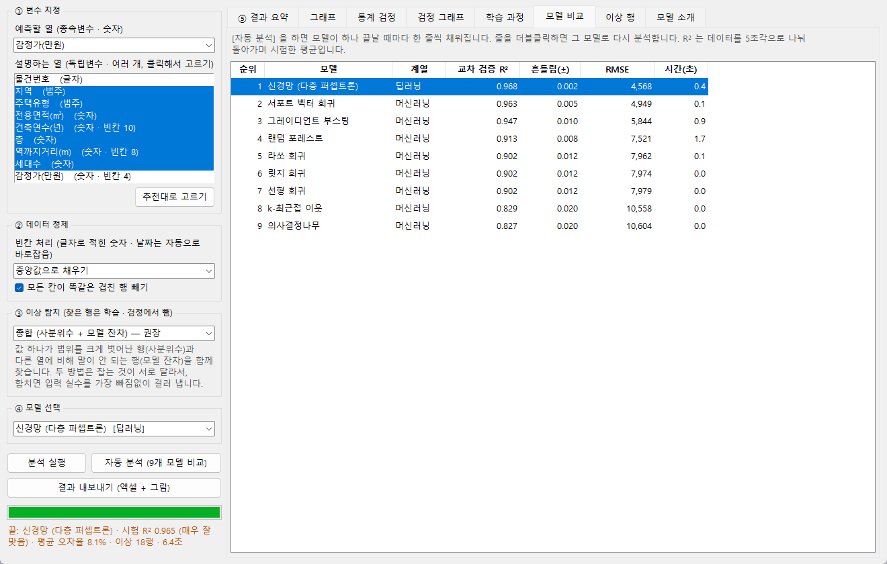

### 11-6. 결과 그래프

[그래프] 탭의 4장입니다.

| 그래프 | 보는 법 |
| --- | --- |
| ① 실제 값과 예측 값 | 점이 대각선에 붙을수록 잘 맞힌 것 (따로 떼어 둔 시험 데이터 20%) |
| ② 예측이 빗나간 정도 | 실제 − 예측. 0 둘레에 고르게 흩어져야 좋음. 한쪽으로 쏠리거나 부채꼴이면 모델이 놓친 것이 있음 |
| ③ 열 중요도 | 그 열의 값을 뒤섞었을 때 정확도가 얼마나 떨어지는가. 어떤 모델에도 똑같이 쓰는 방식 |
| ④ 모델 비교 | 교차 검증 R². 빨강이 고른 모델 (자동 분석을 안 했으면 이상 행 산점도) |

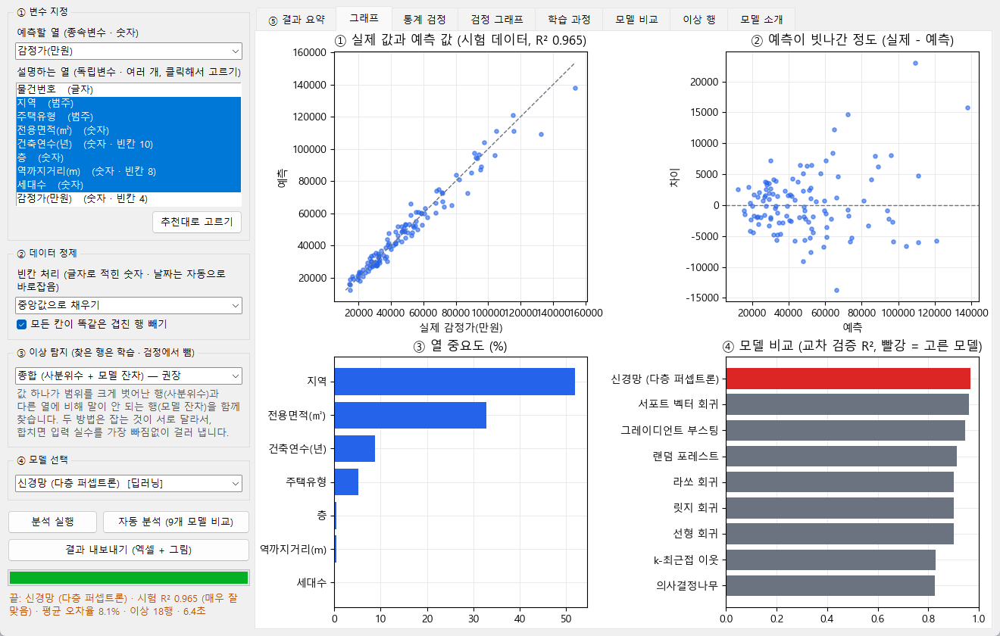

### 11-7. 학습 과정 — 진행 상황과 학습 곡선

계산은 작업 스레드에서 하므로 도는 동안에도 창이 멈추지 않습니다. 그동안 무엇을 하고 있는지를 세 군데에 보여 줍니다.

- **진행 막대**(왼쪽 아래)와 그 아래 한 줄 상태
- **[학습 과정] 탭의 진행 기록** — 걸린 시간과 한 일이 한 줄씩 실시간으로 쌓입니다(정제 내역 → 이상 탐지 → 모델 9개 각각의 점수 → 통계 검정 → 학습 곡선).
- **[모델 비교] 탭** — 모델이 하나 끝날 때마다 한 줄씩 채워집니다.

끝나면 같은 탭에 학습 과정 그래프가 나옵니다.

| 그래프 | 보는 법 |
| --- | --- |
| 학습 곡선 (왼쪽) | 배우는 데 쓴 행 수를 20% → 100% 로 늘려 가며 잰 학습 점수(회색)와 시험 점수(빨강). 빨강이 계속 오르면 데이터를 더 모을 가치가 있고, 둘의 간격이 넓으면 학습 데이터를 외운 것(과적합) |
| 단계별 학습 오차 (오른쪽) | 그레이디언트 부스팅은 나무를 하나 보탤 때마다, 신경망은 한 번 되풀이할 때마다 줄어드는 오차. 그 밖의 모델은 빗나간 정도의 분포 |

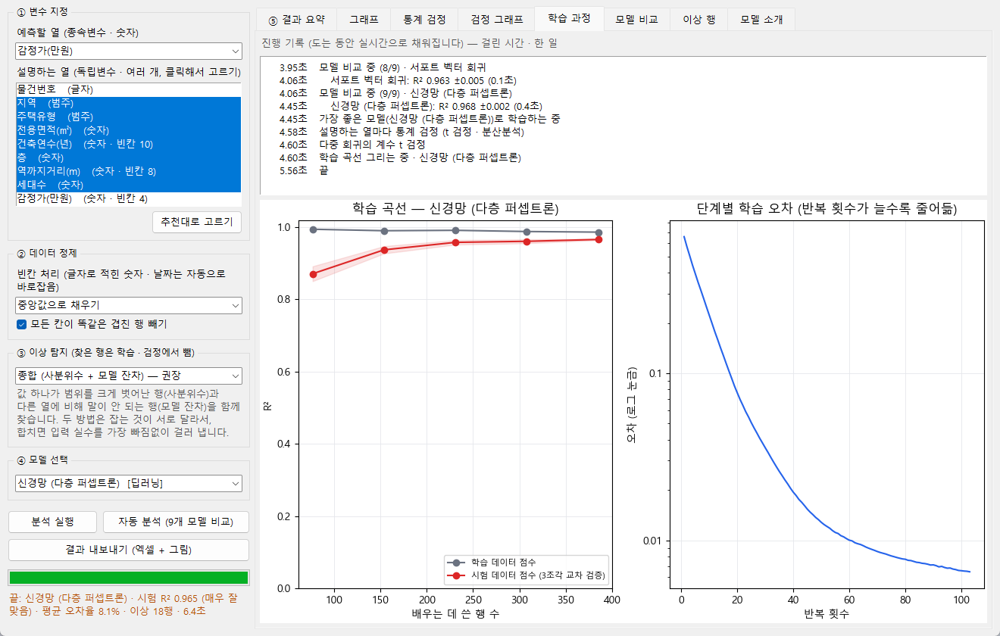

### 11-8. 내보내기

**[결과 내보내기]** 는 엑셀 하나와 그림 3장을 만듭니다.

| 파일 · 시트 | 내용 |
| --- | --- |
| `…_내보내기.xlsx` / 예측결과 | 원래 표 + 행마다 예측값 · 차이(실제 − 예측) · 이상 여부(이유) |
| / 모델비교 | 모델 9가지의 순위 · R² · RMSE · 걸린 시간 |
| / 요약 | [결과 요약] 탭의 글 |
| / 통계검정 | 열마다 검정 방법 · 통계량 · 자유도 · p 값 · 효과 크기 · 풀이 |
| / 회귀계수 | 계수 · 표준오차 · t · p 값 · 95% 신뢰구간 |
| `….png` · `…_검정.png` · `…_학습.png` | [그래프] · [검정 그래프] · [학습 과정] 탭의 그림 |

### 11-9. 연습용 표로 해 본 결과

연습용 표 네 개를 같은 절차로 돌린 결과입니다. 전체 표와 그래프 12장은 **[docs/sample_analysis.md](docs/sample_analysis.md)** 에 있고, `python sample_report.py` 로 언제든 다시 만들 수 있습니다.

| 표 | 행 (정제 전 → 후) | 이상 행 | 유의한 열 | 1위 모델 | 교차 검증 R² |
| --- | --- | --- | --- | --- | --- |
| 보금자리론 신청 (2026년 10월) | 240 → 240 | 0 | 1 / 6 | 라쏘 회귀 | 0.009 |
| 보금자리론 3개월 취합 (샘플 S1 의 결과) | 630 → 630 | 0 | 0 / 8 | 라쏘 회귀 | -0.015 |
| 주택연금 가입현황 — 정제 전 (샘플 S3 의 입력) | 62 → 59 | 0 | 0 / 4 | 라쏘 회귀 | -0.607 |
| 주택 감정가 (분석 연습용) | 604 → 596 | 18 | 5 / 7 | 신경망 (다층 퍼셉트론) | 0.968 |

- 앞의 세 표는 수업용으로 **값을 무작위로 만든** 표입니다. 그래서 "관계가 없다"가 정답이고, 분석도 그렇게 나옵니다 — 유의한 열이 거의 없고 R² 가 0 근처이거나 음수입니다(음수 = 평균값만 찍는 것보다 못함). **도구가 없는 관계를 지어내지 않는다**는 확인이기도 합니다.
- 10월 표에서는 `처리상태` 하나가 뚜렷하게 유의하다고 나왔지만(F = 5.84, p < 0.001), 값을 무작위로 만든 표이므로 **우연**입니다. 3개월 치를 합친 표에서는 사라집니다. p 값이 아주 작아도 한 번의 결과만으로 단정하지 말고 **다른 기간의 데이터로 다시 확인**해야 한다는 본보기입니다.
- 정제 전 표는 금액 · 날짜를 바로잡고 겹친 행을 뺀 뒤에야 분석할 수 있었습니다. 59행으로 지점 17곳을 견주기에는 행이 너무 적어 모델 점수가 크게 음수입니다.
- 마지막 표는 열 사이에 관계를 넣어 만든 표라서 같은 절차로 R² 0.97 이 나옵니다.

무작위로 만든 수업 표의 검정 화면입니다. 거의 모든 열이 "유의하지 않음"이고 상자그림이 서로 겹칩니다.

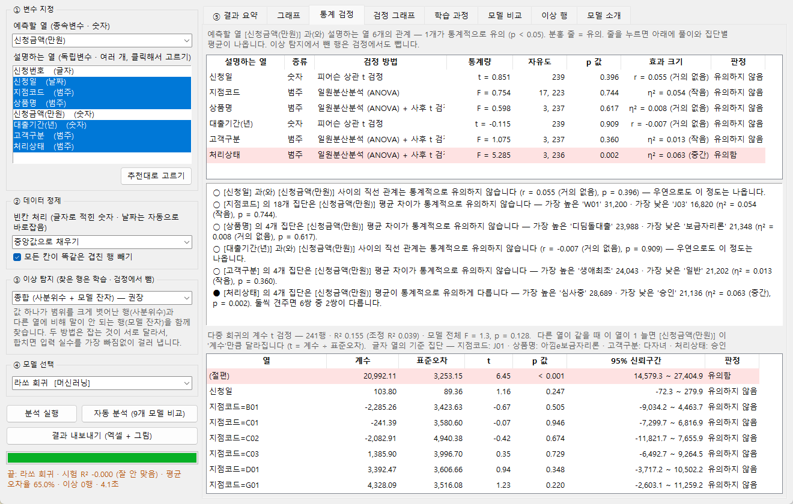

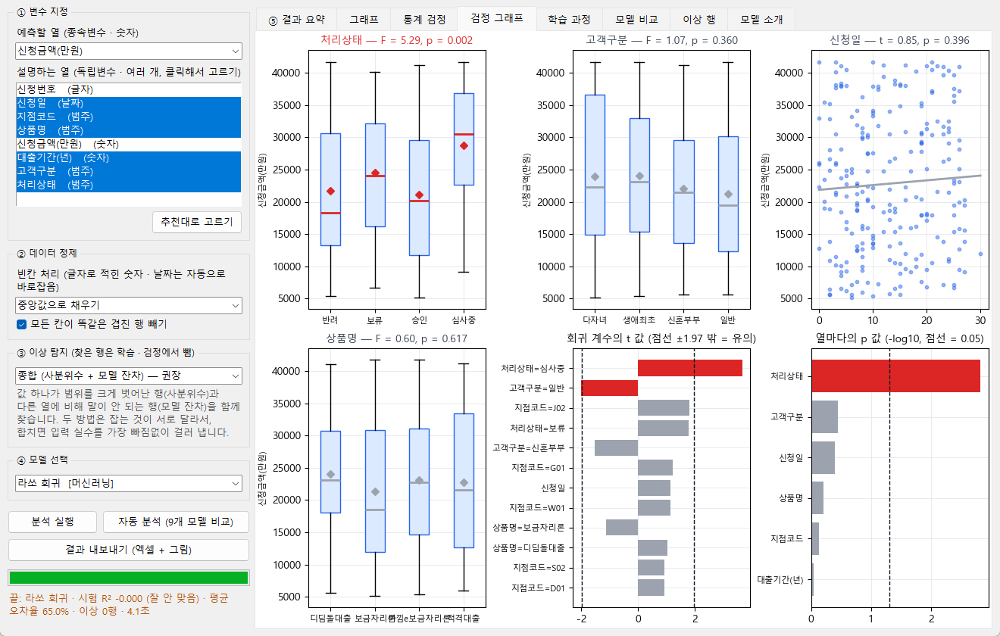

### 11-10. 따라 해 보기 (10분)

연습용 파일 `samples\주택_감정가_분석연습.xlsx` 는 지어낸 데이터 604행입니다. 일부러 빈칸 22칸, 겹친 행 4개, 잘못 입력한 값 9개(감정가나 면적에 0 을 하나 더 넣음)를 섞어 두었습니다.

1. 파일을 열고 **[회귀 분석]** → 예측할 열 `감정가(만원)`, 설명하는 열 7개가 추천되어 있음
2. ③ 을 `탐지 안 함`, ④ 를 `선형 회귀` 로 두고 **[분석 실행]** → R² 가 0.3 쯤 (잘 안 맞음)
3. ③ 을 `종합` 으로 바꾸고 다시 → 18행이 빠지고 R² 가 0.9 쯤으로 오름. [이상 행] 탭에서 이유 확인
4. [통계 검정] 탭 → `지역` · `전용면적` 은 유의, `세대수` · `역까지거리` 는 유의하지 않음. `지역` 줄을 눌러 지역별 평균 보기
5. **[자동 분석]** → [학습 과정] 탭에 모델이 하나씩 끝나는 기록이 쌓이고, 1위 모델로 학습 (R² 0.96 쯤)
6. [모델 비교] 탭에서 다른 모델을 더블클릭해 견주어 보기, [학습 과정] 탭에서 학습 곡선 보기
7. [이상 행] 탭의 **[편집기에서 이 행들만 보기]** → 편집기에서 값을 고친 뒤 다시 분석하면 고친 값이 반영됨
8. **[결과 내보내기]** → 엑셀(시트 5개)과 그림 3장
9. 이번에는 `samples\보금자리론_신청_2026_10.xlsx` 로 [자동 분석] → 관계가 없는 표에서는 어떻게 나오는지 견주어 보기

### 11-11. 코드로 자동화하기

화면 없이 몇 줄로 같은 일을 할 수 있습니다. 매달 같은 양식의 파일이 들어온다면 이 코드를 그대로 돌리면 됩니다. (`sample_report.py` 가 이 방식으로 보고서를 만듭니다.)

```python
import data_editor as ed
import analysis as an
import stat_tests as st

source = ed.open_source(r"samples\주택_감정가_분석연습.xlsx")
df = an.to_frame(source.load(source.tables()[0]))

result = an.auto(df, target="감정가(만원)")          # 정제 → 이상 탐지 → 모델 9개 비교 → 1위로 학습
print("\n".join(result.log))

c, o, best = result.clean, result.outliers, result.best
tests = st.test_all(c, exclude=o.mask)               # 열마다 t 검정 · 분산분석
fit = st.ols(c, exclude=o.mask)                      # 다중 회귀의 계수 t 검정
print("\n".join(st.summary_lines(c, tests, fit, st.describe(c, exclude=o.mask))))

an.export("분석결과_내보내기.xlsx", df, c, o, best, result.table, tests=tests, ols=fit)
an.figure(c, o, best, result.table).savefig("분석결과.png")
st.figure_tests(c, tests, fit, exclude=o.mask).savefig("분석결과_검정.png")
```

| 자동으로 되는 것 | 사람이 정해야 하는 것 |
| --- | --- |
| 변수 추천, 글자로 적힌 숫자 · 날짜 바로잡기, 겹친 행 · 빈칸 처리 | **무엇을** 예측할지, 그 열들이 예측 시점에 알 수 있는 값인지 |
| 이상한 행 찾기와 이유 적기 | 표시된 행이 정말 틀린 값인지, 고칠지 뺄지 |
| 열 종류에 맞는 검정 고르기, p 값 · 효과 크기 · 풀이 문장 | 유의하다는 결과를 어떻게 받아들일지 — 유의하다 ≠ 중요하다, 상관 ≠ 원인 |
| 모델 9가지 비교와 순위, 학습 곡선, 그래프 · 엑셀 만들기 | 결과를 업무에 써도 되는지 |

### 11-12. 알아 둘 것

- 예측할 열은 숫자여야 합니다(회귀). 승인/반려 같은 글자를 맞히는 분류는 들어 있지 않습니다.
- 이상 탐지는 행을 **지우지 않습니다**. 학습 · 검정에서만 빼고 결과에 이유와 함께 남깁니다.
- 전체의 20% 는 배우지 않고 따로 떼어 시험합니다. 화면의 R² 는 그 시험 점수입니다.
- t 검정 · 분산분석은 값이 대체로 종 모양으로 퍼져 있고 행이 서로 독립이라고 가정합니다. 행이 아주 적거나 한쪽으로 심하게 쏠린 값에서는 p 값을 그대로 믿기 어렵습니다(기술통계의 왜도를 함께 보세요).
- 같은 데이터 · 같은 설정이면 결과가 언제나 같습니다(난수 씨앗 고정). 라이브러리 버전이 다르면 소수 셋째 자리쯤에서 달라질 수 있습니다.
- 수만 행이 넘으면 서포트 벡터 회귀와 자동 분석이 느려집니다.

## 12. 파일 구성 · 확인한 환경

| 파일 | 내용 |
| --- | --- |
| `data_editor.py` | 프로그램 전체 (한 파일). 위에서부터 값 다루기 → 메모리에서 고치기 → 엑셀 → Access → 작업 스레드 → 탭 하나 → 창 |
| `analysis.py` | 회귀 분석 계산 (화면 없음): 정제 · 이상 탐지 · 모델 9가지 · 자동 분석 · 학습 곡선 · 그래프 · 엑셀 |
| `stat_tests.py` | 통계 검정 (화면 없음): 기술통계 · 상관 t 검정 · 독립표본 t 검정 · 분산분석 · 회귀 계수 t 검정 · 검정 그래프 |
| `analysis_window.py` | 회귀 분석 · 통계 검정 창 (화면) |
| `sample_report.py` | 연습용 표 네 개를 한 번에 분석해 `docs/sample_analysis.md` 와 그래프를 만듦 |
| `docs/sample_analysis.md` | 연습용 표 분석 결과 (표마다 정제 · 검정 · 모델 비교 · 그래프) |
| `docs/ml_guide.md` | 모델 소개(어원 · 역사 · 기능). `python analysis.py > docs/ml_guide.md` 로 다시 만듦 |
| `docs/concept_guide.md` | 개념 사전: 회귀 · 정제 · 이상 탐지 · t 검정 · 머신러닝의 역사 · 어원 · 개념 · 쓰이는 곳, 그림 12장 |
| `make_guide_figures.py` | 개념 사전의 그림 12장(`docs/figures/`)을 만드는 스크립트 |
| `make_analysis_sample.py` | 분석 연습용 가상 데이터를 만드는 스크립트 |
| `test_analysis.py` | 회귀 분석 테스트 17개 |
| `test_stat_tests.py` | 통계 검정 · 정제 · 학습 곡선 테스트 13개 |
| `notebook_tutorial.ipynb` | 한 칸씩 따라 하는 노트북 |
| `requirements.txt` | 필요한 라이브러리 목록 |
| `requirements-lock.txt` | `pip freeze` 로 만든 버전 고정 목록 (Python 3.13) |
| `reset_samples.py` | 연습용 데이터를 처음 상태로 |
| `test_data_editor.py` | 화면 없이 도는 핵심 기능 테스트 17개 (메모리 · 작업 스레드 포함) |
| `gui_check.py` | 창을 띄워 자동으로 확인하는 점검 80항목 (여러 탭 · 동시에 열기 · 회귀 분석 · 통계 검정 · 수업 샘플 분석 포함) |
| `samples_original/` | 연습용 가상 데이터 원본 (엑셀 6개, Access 1개) |
| `screenshots/` | 실행 화면 |

**확인한 환경 (Windows 11)**

| 항목 | Python 3.13.2 | Python 3.10.11 |
| --- | --- | --- |
| 새 가상 환경 + `pip install -r requirements.txt` | 통과 (39초) | 통과 (46초) |
| 설치된 버전 | scikit-learn 1.9.1 · matplotlib 3.11.2 · pandas 3.1.1 · numpy 2.5.5 | scikit-learn 1.7.2 · matplotlib 3.10.9 · pandas 2.3.3 · numpy 2.2.6 |
| `test_data_editor.py` 17개 | 통과 | 통과 |
| `test_analysis.py` 17개 | 통과 | 통과 |
| `test_stat_tests.py` 13개 | 통과 | 통과 |
| `gui_check.py` 80항목 | 통과 (오류 출력 0줄) | 통과 (오류 출력 0줄) |
| `sample_report.py` (연습용 표 4개 분석 · 그림 12장) | 통과 | 통과 |
| 노트북 코드 12칸 실행 | 통과 | 통과 |
| 자동 분석 (모델 9가지 비교) | 4.9초 · 경고 0건 · 1위 R² 0.968 | 5.3초 · 경고 0건 · 1위 R² 0.968 |
| 분석 라이브러리 없이 (openpyxl 만 설치) | 편집기 정상, 분석 · 검정은 건너뜀 | 편집기 정상, 분석 · 검정은 건너뜀 |

- 위 표는 2026-11-18 에 새 폴더 · 새 가상 환경에서 다시 돌린 결과입니다. `docs/sample_analysis.md` 의 요약 표는 두 환경에서 같은 값이 나왔습니다. `requirements-lock.txt` 는 이때 Python 3.13 환경의 `pip freeze` 입니다. 그 파일로 다른 가상 환경에 설치하는 것은 이번에는 다시 해 보지 않았습니다(2026-11-17 판에서는 통과).
- 노트북은 VS Code 커널이 아니라 코드 칸을 순서대로 실행하는 방식으로 확인했습니다.
- 화면의 단추를 사람이 직접 눌러 보는 확인은 하지 않았습니다. `gui_check.py` 가 같은 동작을 코드로 실행하고 화면을 캡처했습니다(이 문서의 그림).
- 터미널은 Windows PowerShell 5.1 기준으로 확인했습니다. Python 3.11 · 3.12 는 직접 돌려 보지 않았습니다.
- VS Code 화면에서 버튼을 누르는 과정(인터프리터 · 커널 선택)은 글로 적은 순서이며, 자동 점검에는 포함되지 않았습니다.

**알아 둘 것**

- 연습용 데이터는 모두 **가상 데이터**입니다. 실제 기관 · 인물 · 수치와 무관합니다.
- 엑셀은 첫 줄을 열 이름으로 봅니다. 위에 제목 줄이나 병합 칸이 있는 양식에는 맞지 않습니다.
- 차트 · 피벗이 있는 엑셀은 저장 때 일부가 빠질 수 있습니다. 저장 전에 만들어지는 백업을 확인하세요.
- 실제 업무 파일에 쓰기 전에 반드시 복사본으로 먼저 해 보세요.
