# 개념 사전 — 역사 · 어원 · 개념 · 쓰이는 곳

> 사용법은 [README 11절](../README.md#11-회귀-분석--통계-검정--머신러닝), 모델 9가지 각각의 소개는 [ml_guide.md](ml_guide.md) 에 있습니다.
> 이 문서는 "그게 무엇이고 어디서 왔나"를 그림과 함께 적었습니다. 항목마다 **한 줄 개념 → 쉬운 예시 → 이름의 뜻 → 역사 → 주로 쓰이는 곳 → 그림과 설명 → 용어 풀이** 순서입니다.
> 그림 속 숫자는 설명하려고 지어낸 값입니다. 그림은 `python make_guide_figures.py` 로 다시 만들 수 있습니다.

## 목차

1. [데이터 분석의 다섯 단계](#1-데이터-분석의-다섯-단계)
2. [회귀 분석](#2-회귀-분석)
3. [데이터 정제](#3-데이터-정제)
4. [이상 탐지](#4-이상-탐지)
5. [통계 검정과 t 검정](#5-통계-검정과-t-검정)
6. [머신러닝 모델 — 선형 · 나무 · 신경망](#6-머신러닝-모델--선형--나무--신경망)
7. [학습과 검증 — 과적합 · 교차 검증](#7-학습과-검증--과적합--교차-검증)
8. [연표와 용어 미니 사전](#8-연표와-용어-미니-사전)

## 1. 데이터 분석의 다섯 단계

- **한 줄 개념**: 표에서 "무엇이 무엇과 관계있는지"를 찾아 숫자로 말하는 일입니다.
- **쉬운 예시**: 요리와 같습니다. 무엇을 만들지 정하고(변수 지정) → 재료를 다듬고(정제) → 상한 재료를 골라내고(이상 탐지) → 조리법을 고르고(모델) → 맛을 봅니다(결과 확인).
- **이름의 뜻**: 데이터(data)는 라틴어 datum "주어진 것"의 복수형입니다. 분석(analysis)은 그리스어 "풀어서 나누다"에서 왔습니다. 통계(statistics)는 라틴어 status "국가"에서 나온 말로, 원래 나라의 인구와 세금을 세는 일이었습니다.
- **주로 쓰이는 곳**: 매출 · 수요 예측, 심사와 위험 평가, 품질 관리, 설문 분석, 가격 산정.

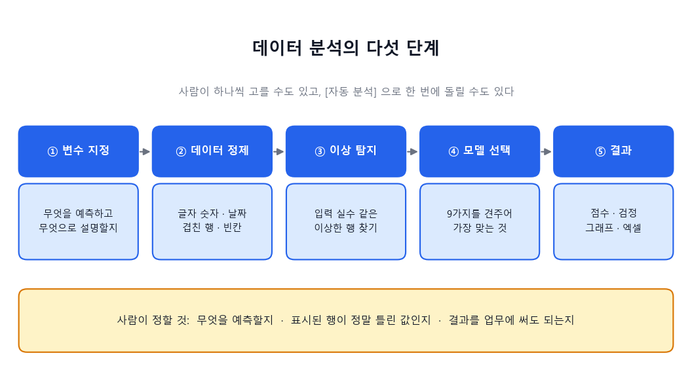

*그림 1. 분석의 다섯 단계. 파란 상자가 단계, 아래 상자가 그 단계에서 하는 일입니다. 노란 상자 — 무엇을 예측할지, 표시된 값이 정말 틀렸는지, 결과를 써도 되는지 — 는 프로그램이 대신해 주지 못합니다.*

## 2. 회귀 분석

- **한 줄 개념**: 점들 사이를 가장 잘 지나가는 선을 그어, 한 값으로 다른 값을 예측합니다.
- **쉬운 예시**: "면적이 넓을수록 집값이 비싸다"는 누구나 압니다. 회귀 분석은 여기서 한 걸음 더 나아가 "1㎡ 넓어지면 평균 얼마 오르는가"를 숫자로 답합니다.
- **이름의 뜻**: regression 은 라틴어 regredi "되돌아가다"입니다. 골턴이 1886년, 키가 아주 큰 부모의 자녀는 크긴 하지만 부모만큼은 아니어서 평균 쪽으로 "되돌아간다"는 것을 발견하고 붙인 이름입니다. 지금은 원래 뜻과 상관없이 "선을 그어 예측하는 방법" 전체를 가리킵니다.
- **역사**: 선을 긋는 계산법인 최소제곱법은 르장드르(1805)와 가우스(1809)가 혜성과 소행성의 궤도를 구하려고 만들었습니다. 80년 뒤 골턴과 피어슨이 사람과 사회의 자료에 쓰기 시작했습니다.
- **주로 쓰이는 곳**: 부동산 감정가 · 중고차 값 산정, 광고비와 매출의 관계, 수요 예측, 약의 용량과 효과.

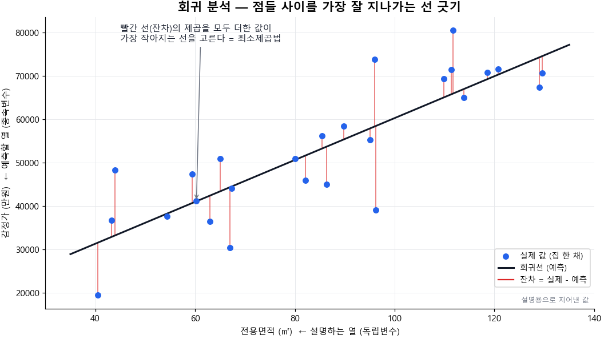

*그림 2. 파란 점은 집 한 채씩, 검은 선이 회귀선(예측)입니다. 빨간 세로선이 잔차 — 실제 값과 예측의 차이 — 이고, 이 빨간 선들의 제곱을 모두 더한 값이 가장 작아지는 선을 고릅니다.*

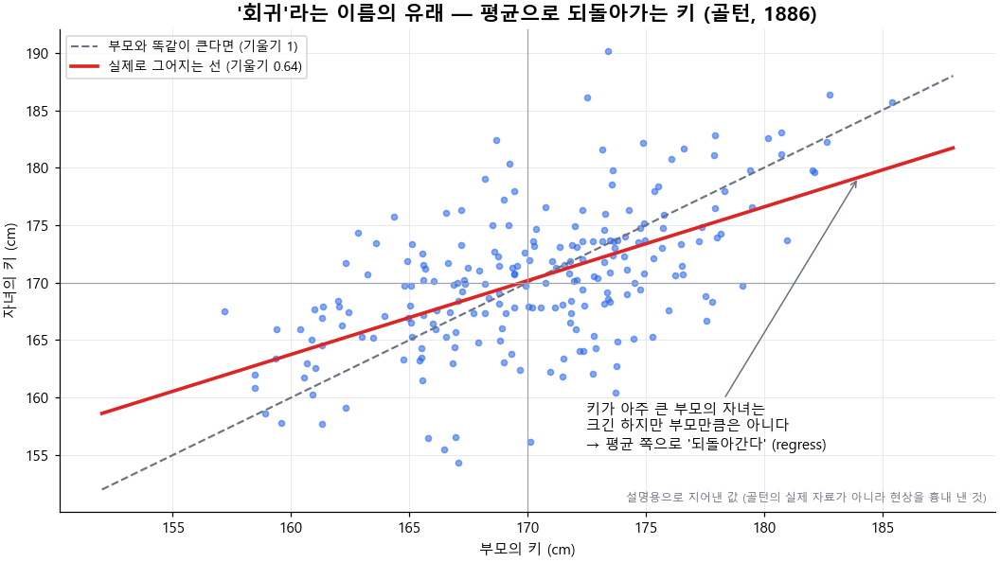

*그림 3. '회귀'라는 이름의 유래. 점선은 "자녀가 부모와 똑같이 큰다면"의 선이고, 빨간 선이 실제로 그어지는 선입니다. 빨간 선이 더 누워 있습니다(기울기 0.64). 큰 부모의 자녀는 평균 쪽으로 조금 되돌아간다는 뜻입니다. (골턴의 실제 자료가 아니라 현상을 흉내 낸 값입니다.)*

| 용어 | 쉬운 말 |
| --- | --- |
| 종속변수 (y) | 예측하고 싶은 열. 다른 값에 "달려 있는" 값 |
| 독립변수 (X) | 설명하는 데 쓰는 열. 원인 후보 |
| 계수 | 설명하는 열이 1 늘 때 예측이 얼마나 달라지는가 |
| 잔차 | 실제 값 − 예측 값. 선이 설명하지 못한 나머지 |
| 결정계수 R² | 선이 값의 오르내림을 얼마나 설명하나 (0 ~ 1) |

## 3. 데이터 정제

- **한 줄 개념**: 계산할 수 있는 모양으로 표를 바로잡는 일입니다. 분석에 드는 시간의 대부분이 여기에 쓰입니다.
- **쉬운 예시**: 사람은 "2,430,000원"과 "2430000"이 같은 값인 줄 알지만 컴퓨터에게 앞의 것은 글자입니다. 더하기가 되지 않습니다.
- **이름의 뜻**: 영어로 data cleaning(청소) 또는 cleansing(씻어 냄)입니다. "쓰레기를 넣으면 쓰레기가 나온다"(Garbage In, Garbage Out)는 1950년대 컴퓨터 초창기부터 내려오는 말입니다.
- **주로 쓰이는 곳**: 여러 지점에서 모은 엑셀 합치기, 설문 응답 정리, 고객 명단의 중복 제거, 시스템을 옮길 때의 자료 이관.

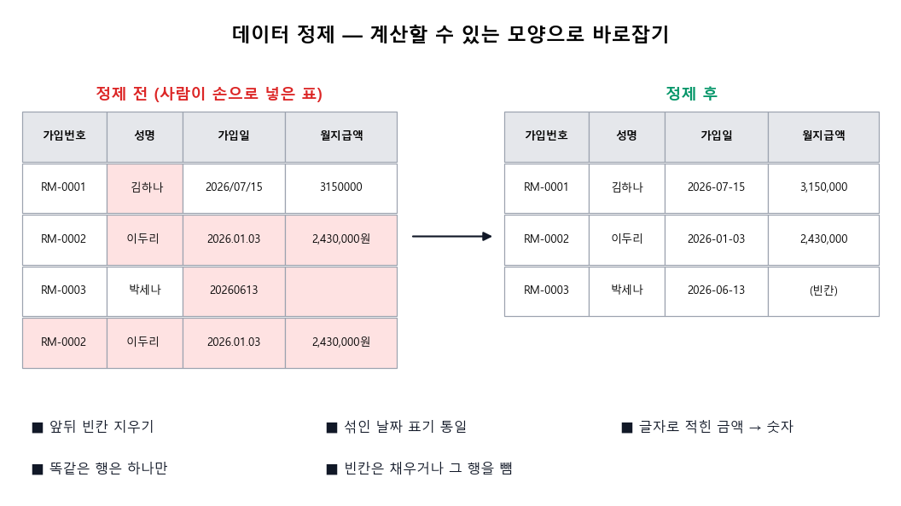

*그림 4. 왼쪽 분홍 칸이 문제입니다: 이름 앞의 빈칸, 세 가지로 섞인 날짜 표기, 글자로 적힌 금액, 빈칸, 똑같은 행. 오른쪽이 바로잡은 모습입니다. 편집기는 이 정제를 스스로 하고 무엇을 했는지 한 줄씩 적어 줍니다.*

| 용어 | 쉬운 말 |
| --- | --- |
| 결측값 | 빈칸. 값이 없는 칸 |
| 중앙값 | 크기순으로 세웠을 때 한가운데 값. 아주 큰 값 하나에 흔들리지 않아 빈칸을 채울 때 평균보다 안전함 |
| 범주형 | "서울 · 부산"처럼 몇 가지 값이 되풀이되는 글자 열 |
| 원-핫 인코딩 | 글자 열을 "서울인가? 부산인가?"의 0/1 열 여러 개로 펼치는 것 |

## 4. 이상 탐지

- **한 줄 개념**: 무리에서 혼자 멀리 떨어진 값을 찾습니다. 틀린 값일 수도 있고, 가장 눈여겨봐야 할 값일 수도 있습니다.
- **쉬운 예시**: 반 학생들의 키를 적다가 170 을 1700 으로 잘못 넣으면, 그 한 칸이 반 평균을 수십 cm 끌어올립니다.
- **이름의 뜻**: outlier 는 out(바깥) + lie(놓이다), 곧 "바깥에 놓인 것"입니다. 우리말로는 이상값 · 이상치라고 합니다.
- **역사**: 터키(John Tukey)가 1977년 책 「탐색적 자료 분석」에서 상자그림을 널리 알렸습니다. 2008년에는 여러 열을 함께 보고 찾는 고립 숲(Isolation Forest)이 나왔습니다.
- **주로 쓰이는 곳**: 카드 부정 사용 탐지, 설비 고장의 조짐 찾기, 입력 오류 점검, 보험 청구 심사.

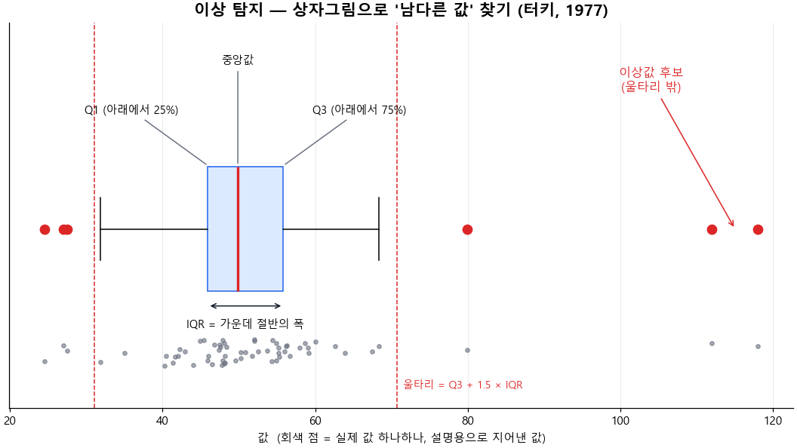

*그림 5. 상자그림 읽는 법. 파란 상자가 가운데 절반(Q1 ~ Q3), 빨간 선이 중앙값입니다. 상자 폭(IQR)의 1.5배를 넘어선 곳에 울타리(점선)를 치고, 그 밖의 빨간 점을 이상값 후보로 봅니다.*

편집기는 이상한 행을 지우지 않고 표시만 합니다. 정말 틀린 값인지, 아주 드문 진짜 값인지는 사람이 판단해야 하기 때문입니다.

## 5. 통계 검정과 t 검정

- **한 줄 개념**: 눈에 보이는 차이가 "우연히 그렇게 나온 것"인지 "진짜 차이"인지를 가립니다.
- **쉬운 예시**: 동전을 10번 던져 앞면이 6번 나왔다고 "이 동전은 앞면이 잘 나온다"고 하지 않습니다. 그 정도는 우연히도 나옵니다. 100번 중 90번이라면 이야기가 다릅니다. 검정은 이 "우연히도 나올 정도인가"를 계산합니다.
- **이름의 뜻**: t 검정의 t 는 고셋(W. S. Gosset)이 논문에서 쓴 기호입니다. 그는 기네스 맥주 회사 직원이어서 본명으로 논문을 낼 수 없었고, Student(학생)라는 필명으로 1908년에 발표했습니다. 그래서 지금도 "스튜던트의 t 검정"이라 부릅니다. 유의(significant)는 "의미가 있다 · 그냥 넘길 수 없다"는 뜻입니다.
- **역사**: 고셋이 맥주 원료를 적은 표본으로 판단하려고 만들었습니다(1908). 피셔(R. A. Fisher)가 1925년 책에서 "p 값이 0.05 보다 작으면 유의하다"는 관례를 퍼뜨렸고, 세 집단 이상을 견주는 분산분석도 그가 만들었습니다.
- **주로 쓰이는 곳**: 신약 임상 시험, 웹사이트 A/B 테스트(두 화면 중 어느 쪽이 더 많이 눌리나), 품질 관리, 설문 조사에서 집단 사이의 차이.

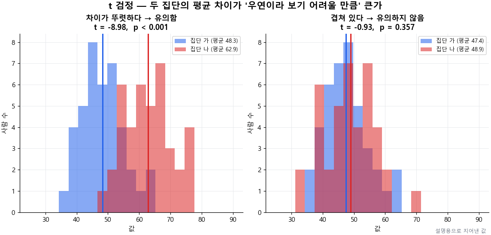

*그림 6. 왼쪽은 두 집단이 뚜렷이 떨어져 있어 "유의함"(p < 0.001), 오른쪽은 거의 겹쳐 "유의하지 않음"(p = 0.357)입니다. 세로선이 각 집단의 평균입니다. 평균 차이만이 아니라 값이 얼마나 퍼져 있는지를 함께 봅니다.*

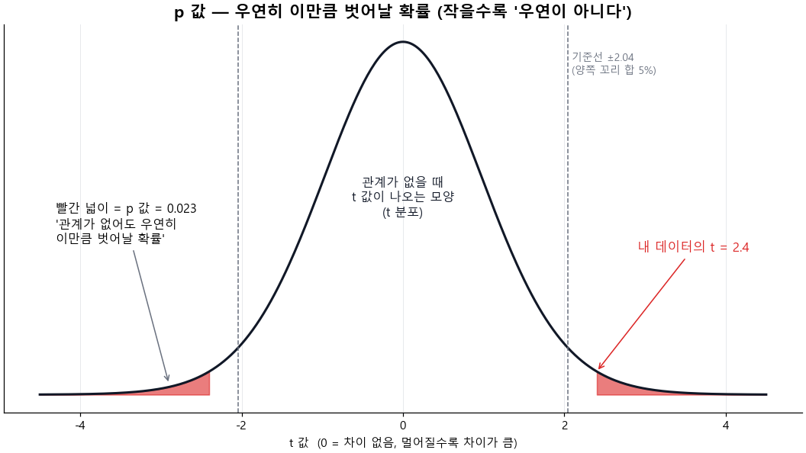

*그림 7. p 값. 종 모양 곡선은 "실제로는 관계가 없을 때" t 값이 나오는 모양입니다. 내 데이터의 t 가 2.4 라면, 우연히 그만큼 벗어날 확률이 빨간 넓이(0.023)입니다. 이 넓이가 0.05 보다 작으면 유의하다고 합니다.*

| 용어 | 쉬운 말 |
| --- | --- |
| 귀무가설 | "차이가 없다"는 기본 가정. 검정은 이것을 무너뜨릴 만한 증거가 있는지 봅니다 |
| p 값 | 차이가 없는데도 우연히 이만큼 벌어질 확률 |
| 유의수준 0.05 | "20번에 1번 나올 우연까지는 우연으로 보겠다"는 약속 |
| t 검정 | 두 집단의 평균을 견줌 |
| 분산분석 (ANOVA) | 세 집단 이상의 평균을 한꺼번에 견줌 |
| 효과 크기 | 차이가 얼마나 큰가. 유의한지와는 따로 봅니다 |

**자주 하는 오해 두 가지**

1. 유의하다 ≠ 중요하다. 행이 수만 개면 아주 작은 차이도 유의해집니다.
2. 유의하다 ≠ 원인이다. 아이스크림 판매량과 물놀이 사고는 함께 오르내리지만, 아이스크림이 사고를 일으키는 것은 아닙니다. 둘 다 더위 때문입니다.

## 6. 머신러닝 모델 — 선형 · 나무 · 신경망

- **한 줄 개념**: 규칙을 사람이 적어 주는 대신, 예시를 많이 보여 주고 규칙을 스스로 찾게 합니다.
- **쉬운 예시**: 아이에게 고양이를 가르칠 때 "귀가 뾰족하고 수염이 있고…" 하고 규칙을 적어 주지 않습니다. 고양이 사진을 여러 장 보여 줍니다.
- **이름의 뜻**: machine learning 은 "기계가 배운다"는 뜻으로, 아서 새뮤얼이 1959년 체커 게임 프로그램을 설명하며 쓴 말입니다. 모델(model)은 라틴어 modulus "작은 본"에서 왔습니다. 세상을 작게 본뜬 것이라는 뜻입니다. 알고리즘(algorithm)은 9세기 수학자 알콰리즈미의 이름에서 왔습니다.

| 가족 | 생각하는 방식 | 주로 쓰이는 곳 |
| --- | --- | --- |
| 선형 계열 (선형 · 릿지 · 라쏘) | 열마다 가중치를 곱해 더한다 | 결과를 말로 설명해야 하는 보고, 기준선 |
| 나무 계열 (의사결정나무 · 랜덤 포레스트 · 그레이디언트 부스팅) | 예/아니오 질문으로 갈라 나간다 | 신용 평가, 고객 이탈 예측, 표 데이터 전반 |
| 이웃 · 경계 (k-최근접 이웃 · 서포트 벡터) | 비슷한 사례를 찾아본다 | 추천, 비슷한 물건 찾기 |
| 신경망 · 딥러닝 | 뉴런 층을 겹쳐 복잡한 모양을 흉내 낸다 | 이미지 · 음성 · 글, 대화형 AI |

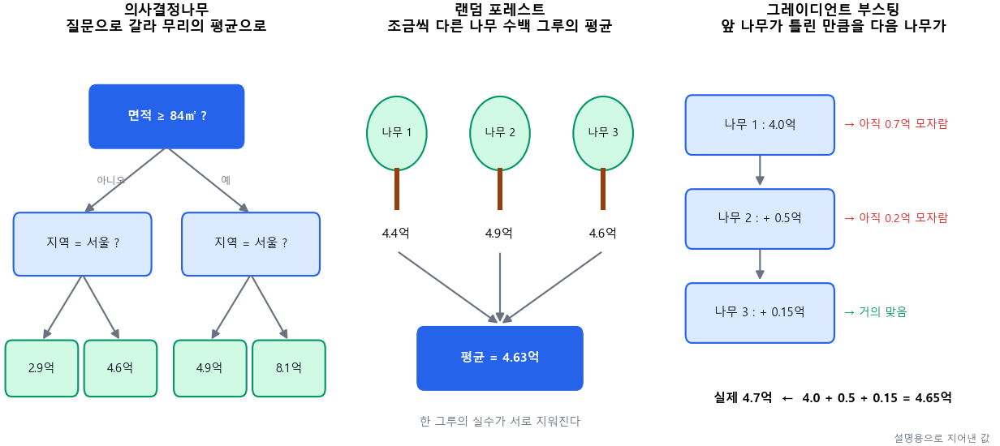

*그림 8. 나무 계열 세 가지. 왼쪽: 나무 한 그루는 질문으로 갈라 무리의 평균을 답합니다. 가운데: 랜덤 포레스트는 조금씩 다른 나무 여러 그루의 답을 평균합니다. 오른쪽: 그레이디언트 부스팅은 앞 나무가 모자랐던 만큼을 다음 나무가 채웁니다.*

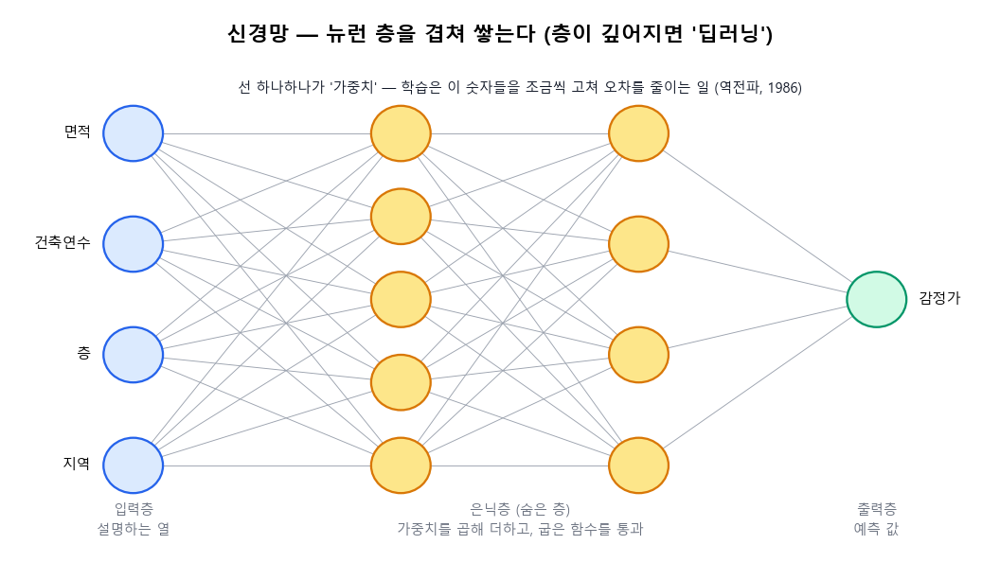

*그림 9. 신경망. 동그라미가 뉴런, 선이 가중치입니다. 왼쪽으로 설명하는 열이 들어가 가운데 층들을 지나 오른쪽에서 예측이 나옵니다. 학습은 이 선들의 숫자를 조금씩 고쳐 오차를 줄이는 일입니다. 가운데 층이 많아지면 딥러닝이라 부릅니다.*

ChatGPT · Claude · Gemini 같은 대화형 AI 도 이 신경망을 아주 크게 키운 것입니다. "다음 말을 예측"하도록 배웠을 뿐인데, 층과 데이터가 충분히 커지니 글을 쓰고 코드를 짜게 됐습니다.

## 7. 학습과 검증 — 과적합 · 교차 검증

- **한 줄 개념**: 모델이 "외운 것"인지 "이해한 것"인지를 처음 보는 데이터로 가립니다.
- **쉬운 예시**: 기출문제의 답만 외운 학생은 그 문제는 다 맞히지만, 숫자만 바꾼 새 문제는 틀립니다. 그래서 시험은 처음 보는 문제로 칩니다. 모델도 같습니다.
- **이름의 뜻**: 과적합(overfitting)은 over(지나치게) + fit(맞추다)입니다. 옷을 한 사람 몸에 지나치게 딱 맞추면 다른 사람은 못 입는 것과 같습니다.
- **역사**: 교차 검증(cross-validation)은 1974년 스톤(M. Stone)이 정리했습니다. 지금은 모델을 견줄 때 거의 반드시 쓰는 절차입니다.

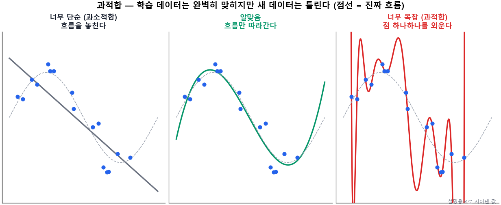

*그림 10. 같은 점들에 그은 세 가지 선. 왼쪽은 너무 단순해 흐름을 놓칩니다. 가운데가 알맞습니다. 오른쪽은 점 하나하나를 다 지나가려다 엉뚱하게 출렁입니다 — 이것이 과적합이고, 새 점이 오면 크게 틀립니다. 점선이 진짜 흐름입니다.*

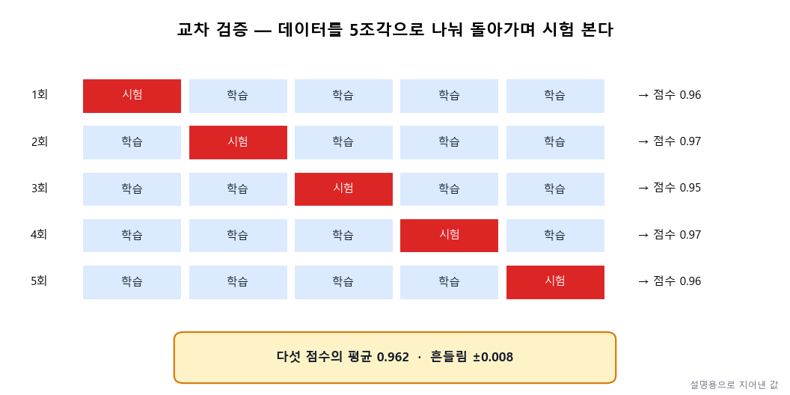

*그림 11. 교차 검증. 데이터를 5조각으로 나눠, 한 조각씩 돌아가며 시험용(빨강)으로 떼어 두고 나머지(파랑)로 배웁니다. 다섯 번의 점수를 평균하면 "운 좋게 쉬운 문제만 걸린 것"을 피할 수 있습니다.*

| 용어 | 쉬운 말 |
| --- | --- |
| 학습 데이터 | 모델이 보고 배우는 행 |
| 시험 데이터 | 배울 때 보여 주지 않고 따로 떼어 둔 행. 편집기는 20% 를 떼어 둡니다 |
| 과적합 | 학습 데이터는 잘 맞히는데 시험 데이터는 못 맞히는 상태 |
| 학습 곡선 | 배우는 행 수를 늘릴 때 시험 점수가 어떻게 변하는지 그린 선 |

## 8. 연표와 용어 미니 사전

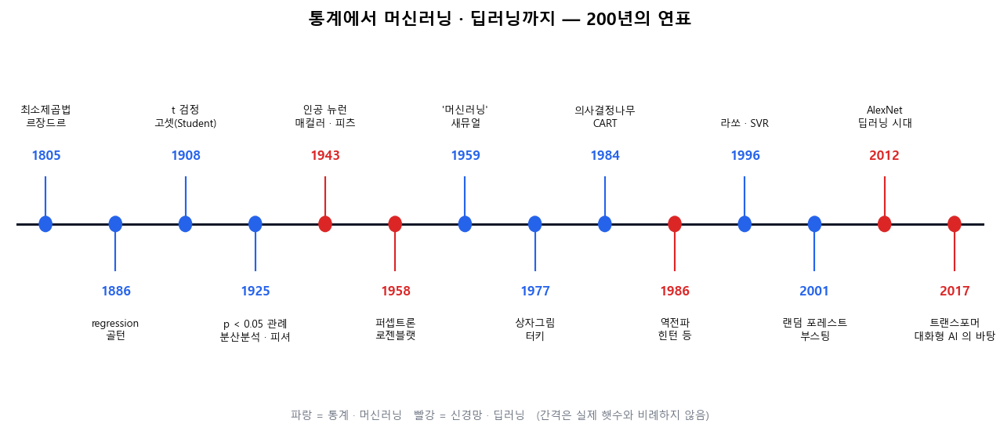

*그림 12. 200년의 연표. 파랑은 통계와 머신러닝, 빨강은 신경망과 딥러닝입니다. 선을 긋는 법(1805)에서 대화형 AI 의 바탕(2017)까지 이어집니다.*

| 연도 | 일어난 일 |
| --- | --- |
| 1805 | 르장드르, 최소제곱법 발표 (가우스는 1809) |
| 1886 | 골턴, "평균으로의 회귀" — regression 이라는 이름 |
| 1908 | 고셋(필명 Student), t 검정 |
| 1925 | 피셔, p < 0.05 관례와 분산분석을 퍼뜨림 |
| 1943 · 1958 | 인공 뉴런(매컬러 · 피츠), 퍼셉트론(로젠블랫) |
| 1959 | 새뮤얼, "머신러닝"이라는 말 |
| 1977 | 터키, 상자그림 |
| 1984 · 2001 | 의사결정나무 CART, 랜덤 포레스트 · 그레이디언트 부스팅 |
| 1986 | 역전파 — 여러 층의 신경망을 배울 수 있게 됨 |
| 2012 | AlexNet — 딥러닝 시대의 시작 |
| 2017 | 트랜스포머 — 대화형 AI 의 바탕 |

| 용어 | 영어 | 한 줄 풀이 |
| --- | --- | --- |
| 변수 | variable | 표의 열 하나. 값이 행마다 "변하는" 것 |
| 표본 | sample | 전체 중에서 실제로 모은 일부 |
| 평균 · 중앙값 | mean · median | 다 더해 나눈 값 · 한가운데 값 |
| 표준편차 | standard deviation | 값들이 평균에서 보통 얼마나 떨어져 있는가 |
| 상관 | correlation | 두 값이 함께 오르내리는 정도 (−1 ~ 1) |
| 특성 | feature | 머신러닝에서 설명하는 열을 부르는 말 |
| 학습 | training · fitting | 데이터에 맞는 숫자(가중치)를 찾는 일 |
| 예측 | prediction | 배운 것으로 새 행의 값을 맞히는 일 |
| 딥러닝 | deep learning | 층을 깊게 쌓은 신경망으로 배우는 방법 |
| LLM | large language model | 글을 아주 많이 읽고 "다음 말"을 예측하도록 배운 큰 신경망 |
