# 연습용 표 분석 결과

> 이 문서는 `python sample_report.py` 가 자동으로 만듭니다. 표마다 **정제 → 이상 탐지 → 기술통계 → 통계 검정(t 검정 · 분산분석) → 회귀 계수 t 검정 → 모델 9가지 비교 → 학습 곡선** 을 같은 순서로 돌렸습니다. 모든 값은 가상 데이터입니다.

## 한눈에

| 표 | 행 (정제 전 → 후) | 이상 행 | 유의한 열 | 1위 모델 | 교차 검증 R² |
| --- | --- | --- | --- | --- | --- |
| 보금자리론 신청 (2026년 10월) | 240 → 240 | 0 | 1 / 6 | 라쏘 회귀 | 0.009 |
| 보금자리론 3개월 취합 (샘플 S1 의 결과) | 630 → 630 | 0 | 0 / 8 | 라쏘 회귀 | -0.015 |
| 주택연금 가입현황 — 정제 전 (샘플 S3 의 입력) | 62 → 59 | 0 | 0 / 4 | 라쏘 회귀 | -0.607 |
| 주택 감정가 (분석 연습용) | 604 → 596 | 18 | 5 / 7 | 신경망 (다층 퍼셉트론) | 0.968 |

- 앞의 세 표는 수업용으로 **값을 무작위로 만든** 표입니다. 그래서 '관계가 없다'가 정답이고, 분석도 그렇게 나옵니다 — 유의한 열이 거의 없고 R² 가 0 근처이거나 음수입니다. 도구가 없는 관계를 지어내지 않는다는 확인이기도 합니다.
- 마지막 표는 열 사이에 관계를 넣어 만든 표라서 같은 절차로 R² 0.97 이 나옵니다.
- 무작위 표에서도 '유의한 열'이 나올 수 있습니다. 10월 표의 `처리상태` 가 그렇습니다(p < 0.001). 값을 무작위로 만들었으니 우연이고, 3개월 치를 합친 표에서는 사라집니다. p 값이 아주 작아도 한 번의 결과로 단정하지 말고 다른 기간의 데이터로 다시 확인해야 합니다.

## 보금자리론 신청 (2026년 10월)

`samples_original/보금자리론_신청_2026_10.xlsx` · 시트 `신청내역` — 수업의 기본 연습 파일. 신청금액을 다른 열로 설명할 수 있는지 본다.

**한 줄 결론** — **이 열들로는 [신청금액(만원)] 을(를) 예측할 수 없습니다** (1위 모델의 교차 검증 R² 0.009 — 0 이하는 '평균값만 찍는 것보다 못하다'는 뜻). 관계가 없는 데이터에서는 어떤 모델을 써도 마찬가지입니다. 통계 검정에서 유의한 열은 6개 중 1개 (처리상태)입니다.

### 1) 정제

- 처음 240행 · 예측할 열 [신청금액(만원)] · 설명하는 열 6개
- [신청일] 날짜를 '첫 날부터 지난 날 수' 로 바꿨습니다.
- 정제 후 240행 · 모델에 들어가는 열 32개

### 2) 이상 탐지

- 이상 탐지 [종합 (사분위수 + 모델 잔차) — 권장] : 240행 중 0행 (0.0%)

### 3) 기술통계

| 열 | n | 평균 | 표준편차 | 최소 | 중앙값 | 최대 | 왜도 |
| --- | --- | --- | --- | --- | --- | --- | --- |
| 신청금액(만원) | 240 | 22,852.5 | 10,711.4 | 5,200.0 | 22,050.0 | 41,700.0 | 0.13 |
| 신청일 | 240 | 12.9 | 8.0 | 0.0 | 12.0 | 27.0 | 0.20 |
| 대출기간(년) | 240 | 22.3 | 10.8 | 10.0 | 20.0 | 40.0 | 0.48 |

### 4) 통계 검정 — 설명하는 열과 [신청금액(만원)] 의 관계

| 설명하는 열 | 검정 방법 | 통계량 | 자유도 | p 값 | 효과 크기 | 판정 |
| --- | --- | --- | --- | --- | --- | --- |
| 신청일 | 피어슨 상관 t 검정 | t = 1.000 | 238 | 0.318 | r = 0.065 (거의 없음) | 유의하지 않음 |
| 지점코드 | 일원분산분석 (ANOVA) | F = 0.720 | 17, 222 | 0.780 | η² = 0.052 (작음) | 유의하지 않음 |
| 상품명 | 일원분산분석 (ANOVA) + 사후 t 검정 | F = 0.515 | 3, 236 | 0.672 | η² = 0.007 (거의 없음) | 유의하지 않음 |
| 대출기간(년) | 피어슨 상관 t 검정 | t = -0.068 | 238 | 0.945 | r = -0.004 (거의 없음) | 유의하지 않음 |
| 고객구분 | 일원분산분석 (ANOVA) + 사후 t 검정 | F = 0.983 | 3, 236 | 0.401 | η² = 0.012 (작음) | 유의하지 않음 |
| 처리상태 | 일원분산분석 (ANOVA) + 사후 t 검정 | F = 5.840 | 3, 236 | < 0.001 | η² = 0.069 (중간) | **유의함** |

- [신청일] 과(와) [신청금액(만원)] 사이의 직선 관계는 통계적으로 유의하지 않습니다 (r = 0.065 (거의 없음), p = 0.318) — 우연으로도 이 정도는 나옵니다.
- [지점코드] 의 18개 집단은 [신청금액(만원)] 평균 차이가 통계적으로 유의하지 않습니다 — 가장 높은 'W01' 31,200 · 가장 낮은 'J03' 16,820 (η² = 0.052 (작음), p = 0.780).
- [상품명] 의 4개 집단은 [신청금액(만원)] 평균 차이가 통계적으로 유의하지 않습니다 — 가장 높은 '디딤돌대출' 23,988 · 가장 낮은 '보금자리론' 21,518 (η² = 0.007 (거의 없음), p = 0.672).
- [대출기간(년)] 과(와) [신청금액(만원)] 사이의 직선 관계는 통계적으로 유의하지 않습니다 (r = -0.004 (거의 없음), p = 0.945) — 우연으로도 이 정도는 나옵니다.
- [고객구분] 의 4개 집단은 [신청금액(만원)] 평균 차이가 통계적으로 유의하지 않습니다 — 가장 높은 '생애최초' 24,043 · 가장 낮은 '일반' 21,350 (η² = 0.012 (작음), p = 0.401).
- [처리상태] 의 4개 집단은 [신청금액(만원)] 평균이 통계적으로 유의하게 다릅니다 — 가장 높은 '심사중' 29,179 · 가장 낮은 '승인' 21,136 (η² = 0.069 (중간), p < 0.001). 둘씩 견주면 6쌍 중 2쌍이 다릅니다.
- 열을 6개 검정하면 관계가 전혀 없어도 우연히 유의하게 나오는 열이 평균 0.3개쯤 생깁니다. 유의한 열이 한둘이고 효과 크기가 작다면 우연일 수 있습니다.

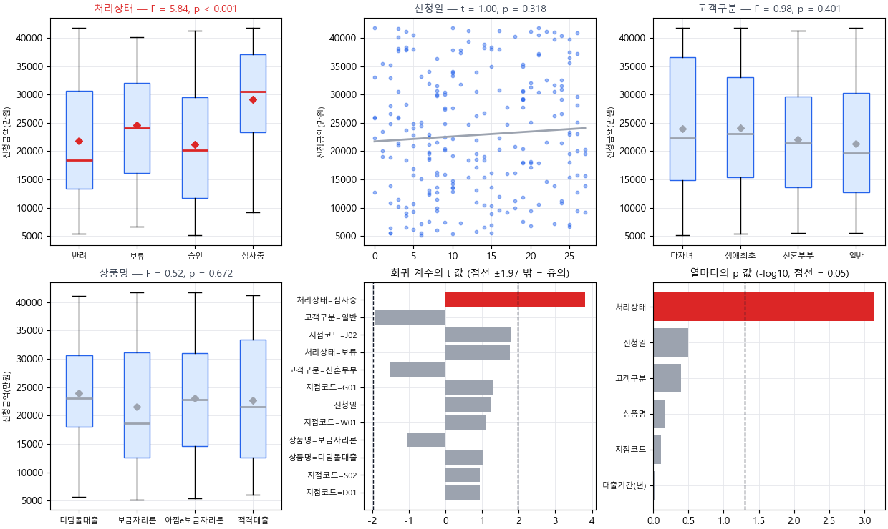

### 5) 다중 회귀의 계수 t 검정

240행 · R² 0.155 (조정 R² 0.043) · 모델 전체 F = 1.38, p = 0.104 · 글자 열의 기준 집단 — 지점코드: J01 · 상품명: 아낌e보금자리론 · 고객구분: 다자녀 · 처리상태: 승인

| 열 | 계수 | 표준오차 | t | p 값 | 95% 신뢰구간 | 판정 |
| --- | --- | --- | --- | --- | --- | --- |
| (절편) | 20,744.22 | 3,252.98 | 6.38 | < 0.001 | 14,331.7 ~ 27,156.7 | **유의함** |
| 처리상태=심사중 | 8,329.97 | 2,183.44 | 3.82 | < 0.001 | 4,025.8 ~ 12,634.1 | **유의함** |
| 고객구분=일반 | -3,770.83 | 1,944.87 | -1.94 | 0.054 | -7,604.7 ~ 63.0 | 유의하지 않음 |
| 지점코드=J02 | 6,718.80 | 3,717.21 | 1.81 | 0.072 | -608.8 ~ 14,046.4 | 유의하지 않음 |
| 처리상태=보류 | 3,760.87 | 2,127.74 | 1.77 | 0.079 | -433.5 ~ 7,955.2 | 유의하지 않음 |
| 고객구분=신혼부부 | -3,024.14 | 1,990.11 | -1.52 | 0.130 | -6,947.2 ~ 898.9 | 유의하지 않음 |
| 지점코드=G01 | 4,512.21 | 3,452.30 | 1.31 | 0.193 | -2,293.2 ~ 11,317.6 | 유의하지 않음 |
| 신청일 | 111.73 | 89.39 | 1.25 | 0.213 | -64.5 ~ 287.9 | 유의하지 않음 |
| 지점코드=W01 | 7,428.05 | 6,796.46 | 1.09 | 0.276 | -5,969.6 ~ 20,825.7 | 유의하지 않음 |
| 상품명=보금자리론 | -2,128.59 | 2,010.97 | -1.06 | 0.291 | -6,092.7 ~ 1,835.6 | 유의하지 않음 |
| 상품명=디딤돌대출 | 2,028.32 | 1,989.77 | 1.02 | 0.309 | -1,894.1 ~ 5,950.7 | 유의하지 않음 |
| 지점코드=S02 | 3,041.98 | 3,267.71 | 0.93 | 0.353 | -3,399.6 ~ 9,483.5 | 유의하지 않음 |

(계수 29개 중 절편과 |t| 가 큰 11개만 표시)

### 6) 모델 9가지 비교 (5조각 교차 검증)

| 순위 | 모델 | 계열 | R² | 흔들림(±) | RMSE | 시간(초) |
| --- | --- | --- | --- | --- | --- | --- |
| 1 | 라쏘 회귀 | 머신러닝 | 0.009 | 0.029 | 10,551 | 0.11 |
| 2 | 릿지 회귀 | 머신러닝 | -0.014 | 0.033 | 10,675 | 0.02 |
| 3 | 랜덤 포레스트 | 머신러닝 | -0.040 | 0.111 | 10,781 | 1.15 |
| 4 | 선형 회귀 | 머신러닝 | -0.111 | 0.115 | 11,154 | 0.01 |
| 5 | k-최근접 이웃 | 머신러닝 | -0.186 | 0.140 | 11,539 | 0.17 |
| 6 | 의사결정나무 | 머신러닝 | -0.241 | 0.181 | 11,757 | 0.01 |
| 7 | 그레이디언트 부스팅 | 머신러닝 | -0.332 | 0.208 | 12,174 | 0.54 |
| 8 | 서포트 벡터 회귀 | 머신러닝 | -0.357 | 0.254 | 12,286 | 0.04 |
| 9 | 신경망 (다층 퍼셉트론) | 딥러닝 | -0.426 | 0.250 | 12,594 | 0.40 |

1위 **라쏘 회귀** 로 학습 → 따로 떼어 둔 시험 데이터 48행에서 R² -0.032 · 평균 오차 9,228 · 평균 오차율 51.3% (학습 데이터에서는 R² 0.049)

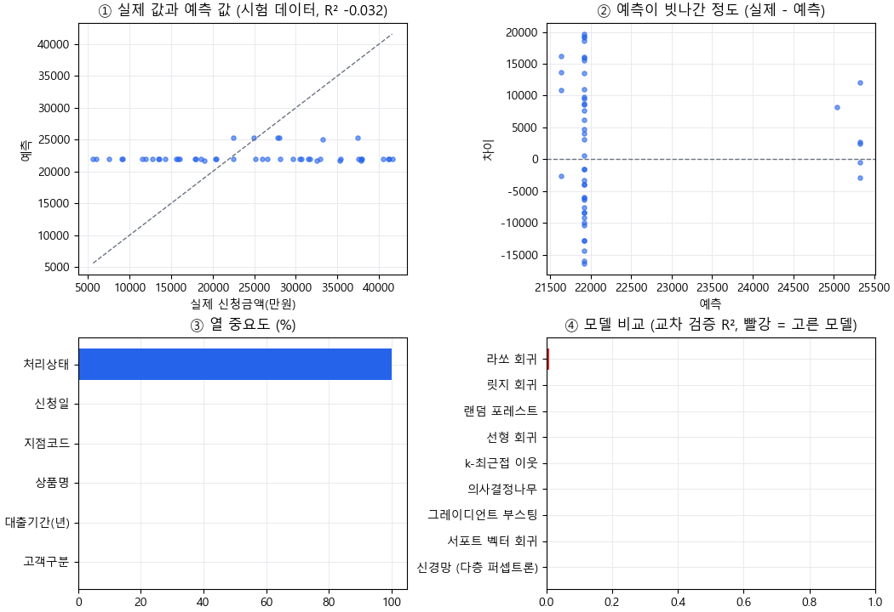

### 7) 학습 과정

배우는 데 쓴 행 수를 늘려 가며 잰 시험 점수: 32행 -0.218 → 64행 0.005 → 96행 0.018 → 128행 0.019 → 160행 -0.012

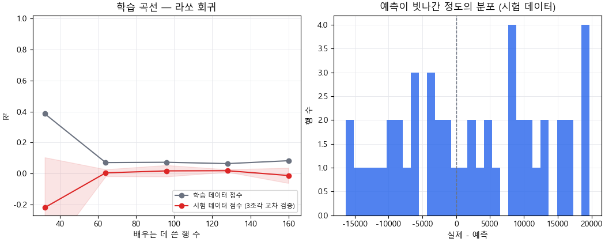

## 보금자리론 3개월 취합 (샘플 S1 의 결과)

`samples_original/S1_보금자리론_취합.xlsx` · 시트 `전체내역` — 월별 파일 3개를 합친 630행. 행이 늘면 결론이 달라지는지 본다.

**한 줄 결론** — **이 열들로는 [신청금액(만원)] 을(를) 예측할 수 없습니다** (1위 모델의 교차 검증 R² -0.015 — 0 이하는 '평균값만 찍는 것보다 못하다'는 뜻). 관계가 없는 데이터에서는 어떤 모델을 써도 마찬가지입니다. 통계 검정에서 유의한 열은 8개 중 0개입니다.

### 1) 정제

- 처음 630행 · 예측할 열 [신청금액(만원)] · 설명하는 열 8개
- [신청일] 날짜를 '첫 날부터 지난 날 수' 로 바꿨습니다.
- 정제 후 630행 · 모델에 들어가는 열 38개

### 2) 이상 탐지

- 이상 탐지 [종합 (사분위수 + 모델 잔차) — 권장] : 630행 중 0행 (0.0%)

### 3) 기술통계

| 열 | n | 평균 | 표준편차 | 최소 | 중앙값 | 최대 | 왜도 |
| --- | --- | --- | --- | --- | --- | --- | --- |
| 신청금액(만원) | 630 | 22,582.9 | 10,455.1 | 5,000.0 | 22,400.0 | 41,900.0 | 0.11 |
| 신청일 | 630 | 47.0 | 25.5 | 0.0 | 49.0 | 88.0 | -0.16 |
| 대출기간(년) | 630 | 22.4 | 10.5 | 10.0 | 20.0 | 40.0 | 0.48 |

### 4) 통계 검정 — 설명하는 열과 [신청금액(만원)] 의 관계

| 설명하는 열 | 검정 방법 | 통계량 | 자유도 | p 값 | 효과 크기 | 판정 |
| --- | --- | --- | --- | --- | --- | --- |
| 신청일 | 피어슨 상관 t 검정 | t = 0.828 | 628 | 0.408 | r = 0.033 (거의 없음) | 유의하지 않음 |
| 지점코드 | 일원분산분석 (ANOVA) | F = 0.895 | 17, 612 | 0.581 | η² = 0.024 (작음) | 유의하지 않음 |
| 상품명 | 일원분산분석 (ANOVA) + 사후 t 검정 | F = 0.245 | 3, 626 | 0.865 | η² = 0.001 (거의 없음) | 유의하지 않음 |
| 대출기간(년) | 피어슨 상관 t 검정 | t = 0.123 | 628 | 0.902 | r = 0.005 (거의 없음) | 유의하지 않음 |
| 고객구분 | 일원분산분석 (ANOVA) + 사후 t 검정 | F = 0.459 | 3, 626 | 0.711 | η² = 0.002 (거의 없음) | 유의하지 않음 |
| 처리상태 | 일원분산분석 (ANOVA) + 사후 t 검정 | F = 0.621 | 3, 626 | 0.602 | η² = 0.003 (거의 없음) | 유의하지 않음 |
| 원본파일 | 일원분산분석 (ANOVA) + 사후 t 검정 | F = 0.155 | 2, 627 | 0.857 | η² = 0.000 (거의 없음) | 유의하지 않음 |
| 신청월 | 일원분산분석 (ANOVA) + 사후 t 검정 | F = 0.155 | 2, 627 | 0.857 | η² = 0.000 (거의 없음) | 유의하지 않음 |

- [신청일] 과(와) [신청금액(만원)] 사이의 직선 관계는 통계적으로 유의하지 않습니다 (r = 0.033 (거의 없음), p = 0.408) — 우연으로도 이 정도는 나옵니다.
- [지점코드] 의 18개 집단은 [신청금액(만원)] 평균 차이가 통계적으로 유의하지 않습니다 — 가장 높은 'J02' 26,645 · 가장 낮은 'J03' 18,127 (η² = 0.024 (작음), p = 0.581).
- [상품명] 의 4개 집단은 [신청금액(만원)] 평균 차이가 통계적으로 유의하지 않습니다 — 가장 높은 '보금자리론' 23,173 · 가장 낮은 '아낌e보금자리론' 22,215 (η² = 0.001 (거의 없음), p = 0.865).
- [대출기간(년)] 과(와) [신청금액(만원)] 사이의 직선 관계는 통계적으로 유의하지 않습니다 (r = 0.005 (거의 없음), p = 0.902) — 우연으로도 이 정도는 나옵니다.
- [고객구분] 의 4개 집단은 [신청금액(만원)] 평균 차이가 통계적으로 유의하지 않습니다 — 가장 높은 '일반' 23,291 · 가장 낮은 '신혼부부' 22,030 (η² = 0.002 (거의 없음), p = 0.711).
- [처리상태] 의 4개 집단은 [신청금액(만원)] 평균 차이가 통계적으로 유의하지 않습니다 — 가장 높은 '심사중' 23,689 · 가장 낮은 '반려' 21,746 (η² = 0.003 (거의 없음), p = 0.602).
- [원본파일] 의 3개 집단은 [신청금액(만원)] 평균 차이가 통계적으로 유의하지 않습니다 — 가장 높은 '보금자리론_신청_2026_10.xlsx' 22,852 · 가장 낮은 '보금자리론_신청_2026_08.xlsx' 22,286 (η² = 0.000 (거의 없음), p = 0.857).
- [신청월] 의 3개 집단은 [신청금액(만원)] 평균 차이가 통계적으로 유의하지 않습니다 — 가장 높은 '2026-10' 22,852 · 가장 낮은 '2026-08' 22,286 (η² = 0.000 (거의 없음), p = 0.857).
- 열을 8개 검정하면 관계가 전혀 없어도 우연히 유의하게 나오는 열이 평균 0.4개쯤 생깁니다. 유의한 열이 한둘이고 효과 크기가 작다면 우연일 수 있습니다.

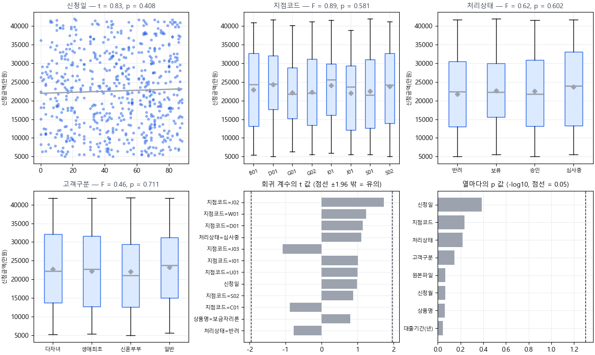

### 5) 다중 회귀의 계수 t 검정

630행 · R² 0.033 (조정 R² -0.015) · 모델 전체 F = 0.69, p = 0.893 · 글자 열의 기준 집단 — 지점코드: G01 · 상품명: 아낌e보금자리론 · 고객구분: 생애최초 · 처리상태: 승인 · 원본파일: 보금자리론_신청_2026_10.xlsx · 신청월: 2026-10  다른 열과 정보가 겹쳐 뺀 열 — 신청월=2026-08, 신청월=2026-09

| 열 | 계수 | 표준오차 | t | p 값 | 95% 신뢰구간 | 판정 |
| --- | --- | --- | --- | --- | --- | --- |
| (절편) | 17,426.89 | 4,557.69 | 3.82 | < 0.001 | 8,475.9 ~ 26,377.9 | **유의함** |
| 지점코드=J02 | 4,634.26 | 2,662.22 | 1.74 | 0.082 | -594.2 ~ 9,862.7 | 유의하지 않음 |
| 지점코드=W01 | 4,052.29 | 3,250.70 | 1.25 | 0.213 | -2,331.9 ~ 10,436.4 | 유의하지 않음 |
| 지점코드=D01 | 2,437.04 | 2,111.52 | 1.15 | 0.249 | -1,709.8 ~ 6,583.9 | 유의하지 않음 |
| 처리상태=심사중 | 1,322.15 | 1,200.04 | 1.10 | 0.271 | -1,034.6 ~ 3,678.9 | 유의하지 않음 |
| 지점코드=J03 | -3,772.53 | 3,491.27 | -1.08 | 0.280 | -10,629.1 ~ 3,084.1 | 유의하지 않음 |
| 지점코드=I01 | 2,123.62 | 2,088.73 | 1.02 | 0.310 | -1,978.5 ~ 6,225.7 | 유의하지 않음 |
| 지점코드=U01 | 2,423.99 | 2,428.96 | 1.00 | 0.319 | -2,346.3 ~ 7,194.3 | 유의하지 않음 |
| 신청일 | 53.18 | 54.21 | 0.98 | 0.327 | -53.3 ~ 159.6 | 유의하지 않음 |
| 지점코드=S02 | 1,785.01 | 2,018.43 | 0.88 | 0.377 | -2,179.1 ~ 5,749.1 | 유의하지 않음 |
| 지점코드=C01 | -1,950.41 | 2,210.50 | -0.88 | 0.378 | -6,291.7 ~ 2,390.9 | 유의하지 않음 |
| 상품명=보금자리론 | 960.15 | 1,195.74 | 0.80 | 0.422 | -1,388.2 ~ 3,308.5 | 유의하지 않음 |

(계수 31개 중 절편과 |t| 가 큰 11개만 표시)

### 6) 모델 9가지 비교 (5조각 교차 검증)

| 순위 | 모델 | 계열 | R² | 흔들림(±) | RMSE | 시간(초) |
| --- | --- | --- | --- | --- | --- | --- |
| 1 | 라쏘 회귀 | 머신러닝 | -0.015 | 0.015 | 10,468 | 0.16 |
| 2 | 릿지 회귀 | 머신러닝 | -0.033 | 0.015 | 10,559 | 0.03 |
| 3 | 선형 회귀 | 머신러닝 | -0.088 | 0.029 | 10,834 | 0.02 |
| 4 | 랜덤 포레스트 | 머신러닝 | -0.109 | 0.036 | 10,945 | 2.51 |
| 5 | k-최근접 이웃 | 머신러닝 | -0.162 | 0.082 | 11,201 | 0.04 |
| 6 | 의사결정나무 | 머신러닝 | -0.228 | 0.064 | 11,517 | 0.02 |
| 7 | 그레이디언트 부스팅 | 머신러닝 | -0.277 | 0.062 | 11,741 | 0.86 |
| 8 | 서포트 벡터 회귀 | 머신러닝 | -0.575 | 0.174 | 13,029 | 0.14 |
| 9 | 신경망 (다층 퍼셉트론) | 딥러닝 | -1.000 | 0.285 | 14,655 | 1.49 |

1위 **라쏘 회귀** 로 학습 → 따로 떼어 둔 시험 데이터 126행에서 R² -0.003 · 평균 오차 9,625 · 평균 오차율 60.6% (학습 데이터에서는 R² 0.000)

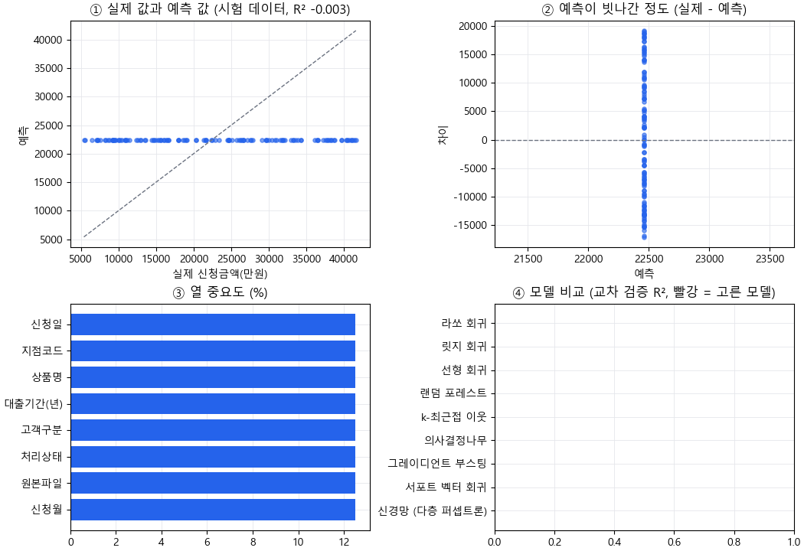

### 7) 학습 과정

배우는 데 쓴 행 수를 늘려 가며 잰 시험 점수: 84행 -0.003 → 168행 -0.001 → 252행 -0.012 → 336행 -0.004 → 420행 -0.001

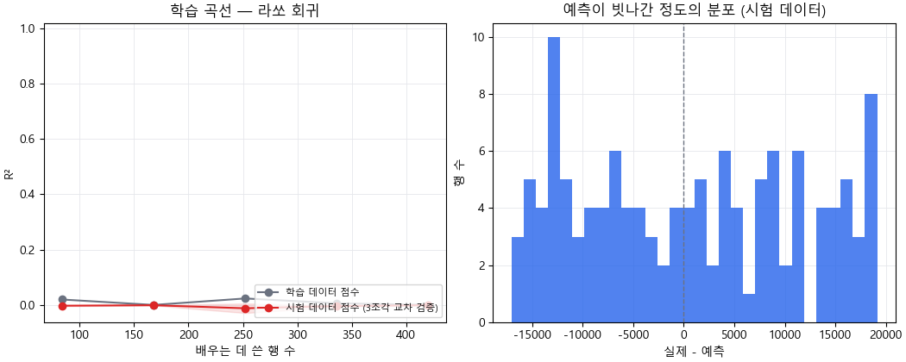

## 주택연금 가입현황 — 정제 전 (샘플 S3 의 입력)

`samples_original/주택연금_가입현황_정제전.xlsx` · 시트 `가입현황` — 금액이 '2,430,000원', 날짜가 '2026.01.03' · '20260613' 처럼 글자로 섞여 있고 겹친 행 · 빈칸이 있는 표.

**한 줄 결론** — **이 열들로는 [월지급액] 을(를) 예측할 수 없습니다** (1위 모델의 교차 검증 R² -0.607 — 0 이하는 '평균값만 찍는 것보다 못하다'는 뜻). 관계가 없는 데이터에서는 어떤 모델을 써도 마찬가지입니다. 통계 검정에서 유의한 열은 4개 중 0개입니다.

### 1) 정제

- 처음 62행 · 예측할 열 [월지급액] · 설명하는 열 4개
- [성명] 앞뒤 빈칸이 있던 12칸을 다듬었습니다.
- [출생연도] 글자로 적힌 숫자 62칸을 숫자로 바꿨습니다 (쉼표 · '원' 제거).
- [가입일] 표기가 섞인 날짜 61칸을 날짜로 바꿨습니다.
- [월지급액] 글자로 적힌 숫자 61칸을 숫자로 바꿨습니다 (쉼표 · '원' 제거).
- 겹친 행 2개를 뺐습니다. (모든 칸이 똑같은 행)
- [월지급액] 이 빈 1행을 뺐습니다. (정답이 없으면 배울 수 없음)
- [가입일] 날짜를 '첫 날부터 지난 날 수' 로 바꿨습니다.
- [가입일] 빈칸 1칸을 중앙값 157 로 채웠습니다.
- [관할지점] 빈칸 1칸을 가장 흔한 값 '경기북부지사' 로 채웠습니다.
- 정제 후 59행 · 모델에 들어가는 열 23개

### 2) 이상 탐지

- 이상 탐지 [종합 (사분위수 + 모델 잔차) — 권장] : 59행 중 0행 (0.0%)

### 3) 기술통계

| 열 | n | 평균 | 표준편차 | 최소 | 중앙값 | 최대 | 왜도 |
| --- | --- | --- | --- | --- | --- | --- | --- |
| 월지급액 | 59 | 1,964,576.3 | 785,972.5 | 480,000.0 | 2,030,000.0 | 3,190,000.0 | -0.25 |
| 출생연도 | 59 | 1,952.5 | 7.0 | 1,940.0 | 1,953.0 | 1,966.0 | 0.04 |
| 가입일 | 59 | 147.6 | 89.3 | 0.0 | 157.0 | 288.0 | -0.16 |

### 4) 통계 검정 — 설명하는 열과 [월지급액] 의 관계

| 설명하는 열 | 검정 방법 | 통계량 | 자유도 | p 값 | 효과 크기 | 판정 |
| --- | --- | --- | --- | --- | --- | --- |
| 출생연도 | 피어슨 상관 t 검정 | t = 1.241 | 57 | 0.220 | r = 0.162 (약함) | 유의하지 않음 |
| 가입일 | 피어슨 상관 t 검정 | t = 1.292 | 57 | 0.202 | r = 0.169 (약함) | 유의하지 않음 |
| 지급방식 | 일원분산분석 (ANOVA) + 사후 t 검정 | F = 0.138 | 3, 55 | 0.937 | η² = 0.007 (거의 없음) | 유의하지 않음 |
| 관할지점 | 일원분산분석 (ANOVA) | F = 0.779 | 14, 42 | 0.685 | η² = 0.206 (큼) | 유의하지 않음 |

- [출생연도] 과(와) [월지급액] 사이의 직선 관계는 통계적으로 유의하지 않습니다 (r = 0.162 (약함), p = 0.220) — 우연으로도 이 정도는 나옵니다.
- [가입일] 과(와) [월지급액] 사이의 직선 관계는 통계적으로 유의하지 않습니다 (r = 0.169 (약함), p = 0.202) — 우연으로도 이 정도는 나옵니다.
- [지급방식] 의 4개 집단은 [월지급액] 평균 차이가 통계적으로 유의하지 않습니다 — 가장 높은 '확정기간' 2,050,000 · 가장 낮은 '종신지급' 1,891,429 (η² = 0.007 (거의 없음), p = 0.937).
- [관할지점] 의 15개 집단은 [월지급액] 평균 차이가 통계적으로 유의하지 않습니다 — 가장 높은 '충북지사' 2,696,667 · 가장 낮은 '광주지사' 835,000 (η² = 0.206 (큼), p = 0.685).

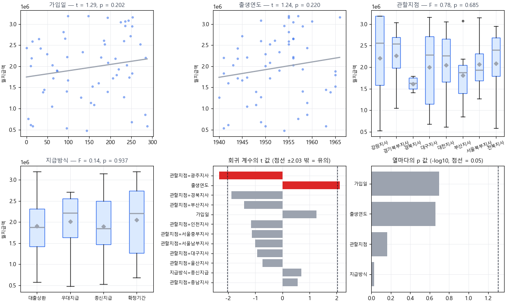

### 5) 다중 회귀의 계수 t 검정

59행 · R² 0.327 (조정 R² -0.055) · 모델 전체 F = 0.86, p = 0.641 · 글자 열의 기준 집단 — 지급방식: 대출상환 · 관할지점: 경기북부지사

| 열 | 계수 | 표준오차 | t | p 값 | 95% 신뢰구간 | 판정 |
| --- | --- | --- | --- | --- | --- | --- |
| (절편) | -72,008,636.41 | 34,972,727.20 | -2.06 | 0.047 | -142,870,112.7 ~ -1,147,160.2 | **유의함** |
| 관할지점=광주지사 | -1,533,927.63 | 656,328.86 | -2.34 | 0.025 | -2,863,776.2 ~ -204,079.1 | **유의함** |
| 출생연도 | 37,861.63 | 17,913.61 | 2.11 | 0.041 | 1,565.2 ~ 74,158.1 | **유의함** |
| 관할지점=경북지사 | -1,009,082.17 | 536,840.33 | -1.88 | 0.068 | -2,096,824.0 ~ 78,659.7 | 유의하지 않음 |
| 관할지점=부산지사 | -675,171.23 | 477,698.94 | -1.41 | 0.166 | -1,643,081.2 ~ 292,738.8 | 유의하지 않음 |
| 가입일 | 1,906.45 | 1,511.91 | 1.26 | 0.215 | -1,157.0 ~ 4,969.9 | 유의하지 않음 |
| 관할지점=인천지사 | -676,158.89 | 585,091.93 | -1.16 | 0.255 | -1,861,667.7 ~ 509,350.0 | 유의하지 않음 |
| 관할지점=서울중부지사 | -738,200.47 | 655,302.21 | -1.13 | 0.267 | -2,065,968.9 ~ 589,567.9 | 유의하지 않음 |
| 관할지점=서울남부지사 | -943,807.30 | 940,928.21 | -1.00 | 0.322 | -2,850,309.0 ~ 962,694.4 | 유의하지 않음 |
| 관할지점=대구지사 | -455,547.18 | 488,466.31 | -0.93 | 0.357 | -1,445,273.9 ~ 534,179.6 | 유의하지 않음 |
| 관할지점=울산지사 | -521,877.83 | 712,932.97 | -0.73 | 0.469 | -1,966,417.2 ~ 922,661.6 | 유의하지 않음 |
| 지급방식=종신지급 | 257,625.98 | 366,988.24 | 0.70 | 0.487 | -485,962.8 ~ 1,001,214.8 | 유의하지 않음 |

(계수 22개 중 절편과 |t| 가 큰 11개만 표시)

### 6) 모델 9가지 비교 (5조각 교차 검증)

| 순위 | 모델 | 계열 | R² | 흔들림(±) | RMSE | 시간(초) |
| --- | --- | --- | --- | --- | --- | --- |
| 1 | 라쏘 회귀 | 머신러닝 | -0.607 | 0.742 | 820,716 | 0.11 |
| 2 | 릿지 회귀 | 머신러닝 | -0.638 | 0.737 | 829,946 | 0.02 |
| 3 | 랜덤 포레스트 | 머신러닝 | -0.815 | 0.649 | 884,072 | 0.78 |
| 4 | 의사결정나무 | 머신러닝 | -0.839 | 0.463 | 909,526 | 0.01 |
| 5 | k-최근접 이웃 | 머신러닝 | -0.880 | 0.760 | 886,830 | 0.04 |
| 6 | 서포트 벡터 회귀 | 머신러닝 | -1.466 | 1.042 | 1,019,495 | 0.03 |
| 7 | 그레이디언트 부스팅 | 머신러닝 | -1.671 | 0.877 | 1,069,076 | 0.46 |
| 8 | 선형 회귀 | 머신러닝 | -1.959 | 1.406 | 1,098,823 | 0.01 |
| 9 | 신경망 (다층 퍼셉트론) | 딥러닝 | -2.192 | 1.669 | 1,129,520 | 0.24 |

1위 **라쏘 회귀** 로 학습 → 따로 떼어 둔 시험 데이터 12행에서 R² -2.042 · 평균 오차 760,745 · 평균 오차율 27.2% (학습 데이터에서는 R² 0.000)

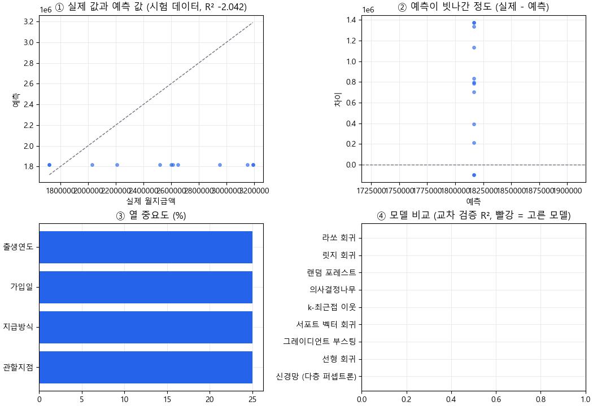

### 7) 학습 과정

배우는 데 쓴 행 수를 늘려 가며 잰 시험 점수: 7행 -3.642 → 15행 -1.677 → 23행 -1.234 → 31행 -1.092 → 39행 -1.125

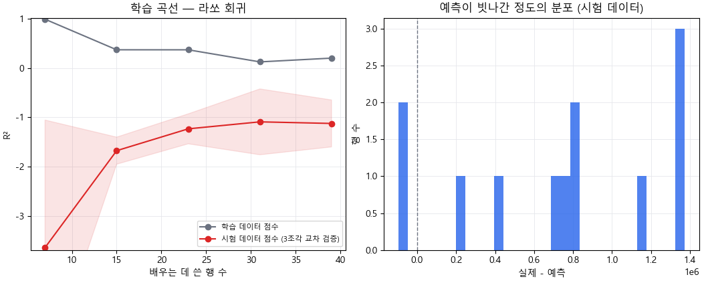

## 주택 감정가 (분석 연습용)

`samples_original/주택_감정가_분석연습.xlsx` · 시트 `감정내역` — 열 사이에 실제 관계를 넣어 만든 표. 입력 실수 9건 · 빈칸 22칸 · 겹친 행 4개를 일부러 넣었다.

**한 줄 결론** — 설명하는 열로 [감정가(만원)] 을(를) 잘 맞힙니다 (1위 모델의 교차 검증 R² 0.968). 통계 검정에서 유의한 열은 7개 중 5개 (지역, 주택유형, 전용면적(㎡), 건축연수(년), 층)입니다.

### 1) 정제

- 처음 604행 · 예측할 열 [감정가(만원)] · 설명하는 열 7개
- 겹친 행 4개를 뺐습니다. (모든 칸이 똑같은 행)
- [감정가(만원)] 이 빈 4행을 뺐습니다. (정답이 없으면 배울 수 없음)
- [건축연수(년)] 빈칸 10칸을 중앙값 19 로 채웠습니다.
- [역까지거리(m)] 빈칸 8칸을 중앙값 1,260 로 채웠습니다.
- 정제 후 596행 · 모델에 들어가는 열 14개

### 2) 이상 탐지

- 이상 탐지 [종합 (사분위수 + 모델 잔차) — 권장] : 596행 중 18행 (3.0%)
  - HM-0016: [감정가(만원)] 156,340 (정상 범위 -67,928 ~ 155,880)
  - HM-0064: [감정가(만원)] 238,900 (정상 범위 -67,928 ~ 155,880) · [감정가(만원)] 238,900 — 다른 열로 보면 26,704 쯤 (8.95배)
  - HM-0098: [감정가(만원)] 26,700 — 다른 열로 보면 45,492 쯤 (0.59배)
  - HM-0177: [감정가(만원)] 188,920 (정상 범위 -67,928 ~ 155,880)
  - HM-0187: [감정가(만원)] 170,300 (정상 범위 -67,928 ~ 155,880) · [전용면적(㎡)] 1,372 (정상 범위 -25.8 ~ 171)
  - … 외 13행

### 3) 기술통계

| 열 | n | 평균 | 표준편차 | 최소 | 중앙값 | 최대 | 왜도 |
| --- | --- | --- | --- | --- | --- | --- | --- |
| 감정가(만원) | 578 | 46,715.2 | 25,736.7 | 10,650.0 | 40,210.0 | 154,130.0 | 1.22 |
| 전용면적(㎡) | 578 | 79.1 | 26.2 | 36.2 | 81.6 | 138.0 | 0.51 |
| 건축연수(년) | 578 | 19.3 | 11.3 | 0.0 | 19.0 | 38.0 | -0.04 |
| 층 | 578 | 10.5 | 8.9 | 1.0 | 8.0 | 28.0 | 0.60 |
| 역까지거리(m) | 578 | 1,256.2 | 711.3 | 89.0 | 1,259.5 | 2,498.0 | 0.04 |
| 세대수 | 578 | 1,054.7 | 753.3 | 1.0 | 1,071.5 | 2,394.0 | 0.09 |

### 4) 통계 검정 — 설명하는 열과 [감정가(만원)] 의 관계

| 설명하는 열 | 검정 방법 | 통계량 | 자유도 | p 값 | 효과 크기 | 판정 |
| --- | --- | --- | --- | --- | --- | --- |
| 지역 | 일원분산분석 (ANOVA) + 사후 t 검정 | F = 85.073 | 5, 572 | < 0.001 | η² = 0.426 (큼) | **유의함** |
| 주택유형 | 일원분산분석 (ANOVA) + 사후 t 검정 | F = 10.959 | 2, 575 | < 0.001 | η² = 0.037 (작음) | **유의함** |
| 전용면적(㎡) | 피어슨 상관 t 검정 | t = 16.904 | 576 | < 0.001 | r = 0.576 (강함) | **유의함** |
| 건축연수(년) | 피어슨 상관 t 검정 | t = -6.807 | 576 | < 0.001 | r = -0.273 (약함) | **유의함** |
| 층 | 피어슨 상관 t 검정 | t = 3.368 | 576 | < 0.001 | r = 0.139 (약함) | **유의함** |
| 역까지거리(m) | 피어슨 상관 t 검정 | t = -0.664 | 576 | 0.507 | r = -0.028 (거의 없음) | 유의하지 않음 |
| 세대수 | 피어슨 상관 t 검정 | t = 0.283 | 576 | 0.777 | r = 0.012 (거의 없음) | 유의하지 않음 |

- [지역] 의 6개 집단은 [감정가(만원)] 평균이 통계적으로 유의하게 다릅니다 — 가장 높은 '서울' 75,503 · 가장 낮은 '광주' 28,575 (η² = 0.426 (큼), p < 0.001). 둘씩 견주면 15쌍 중 11쌍이 다릅니다.
- [주택유형] 의 3개 집단은 [감정가(만원)] 평균이 통계적으로 유의하게 다릅니다 — 가장 높은 '아파트' 49,982 · 가장 낮은 '연립' 38,527 (η² = 0.037 (작음), p < 0.001). 둘씩 견주면 3쌍 중 2쌍이 다릅니다.
- [전용면적(㎡)] 이(가) 클수록 [감정가(만원)] 이(가) 커지는 관계가 통계적으로 유의합니다 (r = 0.576 (강함), p < 0.001).
- [건축연수(년)] 이(가) 클수록 [감정가(만원)] 이(가) 작아지는 관계가 통계적으로 유의합니다 (r = -0.273 (약함), p < 0.001).
- [층] 이(가) 클수록 [감정가(만원)] 이(가) 커지는 관계가 통계적으로 유의합니다 (r = 0.139 (약함), p < 0.001).
- [역까지거리(m)] 과(와) [감정가(만원)] 사이의 직선 관계는 통계적으로 유의하지 않습니다 (r = -0.028 (거의 없음), p = 0.507) — 우연으로도 이 정도는 나옵니다.
- [세대수] 과(와) [감정가(만원)] 사이의 직선 관계는 통계적으로 유의하지 않습니다 (r = 0.012 (거의 없음), p = 0.777) — 우연으로도 이 정도는 나옵니다.
- 열을 7개 검정하면 관계가 전혀 없어도 우연히 유의하게 나오는 열이 평균 0.4개쯤 생깁니다. 유의한 열이 한둘이고 효과 크기가 작다면 우연일 수 있습니다.

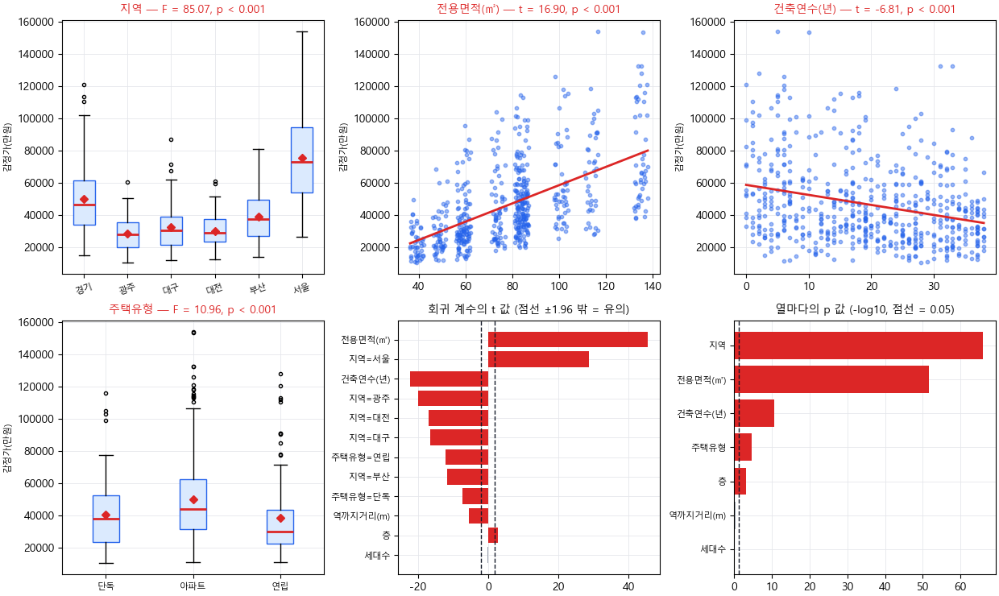

### 5) 다중 회귀의 계수 t 검정

578행 · R² 0.909 (조정 R² 0.908) · 모델 전체 F = 473.11, p < 0.001 · 글자 열의 기준 집단 — 지역: 경기 · 주택유형: 아파트

| 열 | 계수 | 표준오차 | t | p 값 | 95% 신뢰구간 | 판정 |
| --- | --- | --- | --- | --- | --- | --- |
| (절편) | 22,940.34 | 1,721.70 | 13.32 | < 0.001 | 19,558.6 ~ 26,322.1 | **유의함** |
| 전용면적(㎡) | 568.05 | 12.51 | 45.41 | < 0.001 | 543.5 ~ 592.6 | **유의함** |
| 지역=서울 | 27,267.90 | 946.84 | 28.80 | < 0.001 | 25,408.1 ~ 29,127.7 | **유의함** |
| 건축연수(년) | -647.17 | 29.19 | -22.17 | < 0.001 | -704.5 ~ -589.8 | **유의함** |
| 지역=광주 | -22,791.90 | 1,145.58 | -19.90 | < 0.001 | -25,042.0 ~ -20,541.8 | **유의함** |
| 지역=대전 | -20,418.28 | 1,209.89 | -16.88 | < 0.001 | -22,794.7 ~ -18,041.9 | **유의함** |
| 지역=대구 | -17,706.93 | 1,076.74 | -16.45 | < 0.001 | -19,821.8 ~ -15,592.0 | **유의함** |
| 주택유형=연립 | -12,526.90 | 1,027.36 | -12.19 | < 0.001 | -14,544.8 ~ -10,509.0 | **유의함** |
| 지역=부산 | -12,066.69 | 1,033.49 | -11.68 | < 0.001 | -14,096.6 ~ -10,036.7 | **유의함** |
| 주택유형=단독 | -9,583.08 | 1,316.99 | -7.28 | < 0.001 | -12,169.9 ~ -6,996.3 | **유의함** |
| 역까지거리(m) | -2.49 | 0.46 | -5.42 | < 0.001 | -3.4 ~ -1.6 | **유의함** |
| 층 | 130.61 | 47.90 | 2.73 | 0.007 | 36.5 ~ 224.7 | **유의함** |

(계수 13개 중 절편과 |t| 가 큰 11개만 표시)

### 6) 모델 9가지 비교 (5조각 교차 검증)

| 순위 | 모델 | 계열 | R² | 흔들림(±) | RMSE | 시간(초) |
| --- | --- | --- | --- | --- | --- | --- |
| 1 | 신경망 (다층 퍼셉트론) | 딥러닝 | 0.968 | 0.002 | 4,568 | 0.41 |
| 2 | 서포트 벡터 회귀 | 머신러닝 | 0.963 | 0.005 | 4,949 | 0.11 |
| 3 | 그레이디언트 부스팅 | 머신러닝 | 0.947 | 0.010 | 5,844 | 1.02 |
| 4 | 랜덤 포레스트 | 머신러닝 | 0.913 | 0.008 | 7,521 | 1.83 |
| 5 | 라쏘 회귀 | 머신러닝 | 0.902 | 0.012 | 7,962 | 0.10 |
| 6 | 릿지 회귀 | 머신러닝 | 0.902 | 0.012 | 7,974 | 0.02 |
| 7 | 선형 회귀 | 머신러닝 | 0.902 | 0.012 | 7,979 | 0.01 |
| 8 | k-최근접 이웃 | 머신러닝 | 0.829 | 0.020 | 10,558 | 0.02 |
| 9 | 의사결정나무 | 머신러닝 | 0.827 | 0.020 | 10,604 | 0.02 |

1위 **신경망 (다층 퍼셉트론)** 로 학습 → 따로 떼어 둔 시험 데이터 116행에서 R² 0.965 · 평균 오차 3,728 · 평균 오차율 8.1% (학습 데이터에서는 R² 0.988)

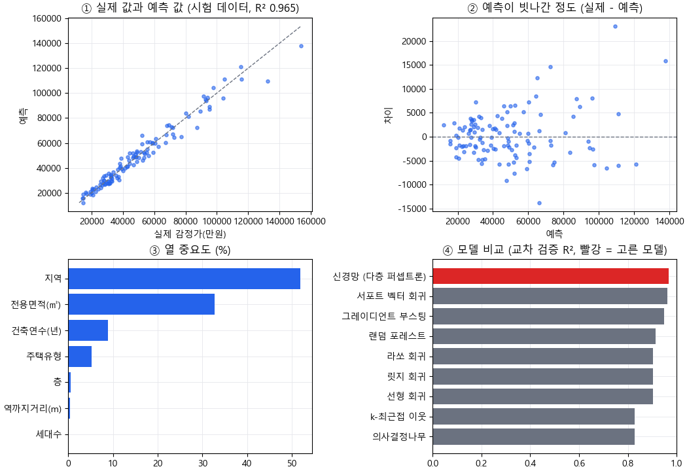

### 7) 학습 과정

배우는 데 쓴 행 수를 늘려 가며 잰 시험 점수: 77행 0.871 → 154행 0.937 → 231행 0.958 → 308행 0.961 → 385행 0.966

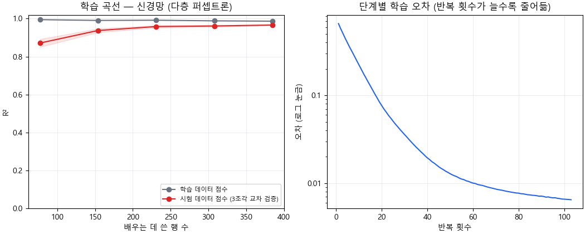

